[TgWitness](../../README.md) / [docs](../README.md)

<picture>
  <source media="(max-width: 640px) and (prefers-reduced-motion: reduce)" srcset="../assets/presentation/section-docs-mobile-static.svg">
  <source media="(prefers-reduced-motion: reduce)" srcset="../assets/presentation/section-docs-static.svg">
  <source media="(max-width: 640px)" srcset="../assets/presentation/section-docs-mobile.svg">
  
</picture>

# Wiki source

Start with [Wiki home](Home.md). These Markdown files are the English source for the
separate GitHub Wiki; they also remain readable inside the main repository.

## Reading paths

| Goal | Guides |
| --- | --- |
| First capture | [Getting started](Getting-Started.md) → [Accounts](Accounts.md) → [Collection](Collection.md) |
| Shared case review | [Access and permissions](Access.md) → [Investigation](Investigations.md) |
| Archive, AI and integrations | [History, search, MCP, OCR and webhooks](Archive-and-Integrations.md) |
| Investigation and handoff | [Investigations](Investigations.md) → [Exports and verification](Exports-and-Verification.md) |
| Export one conversation | [Chat export](Chat-Export.md) → [Verification](Exports-and-Verification.md) |
| Reliable operation | [Proxies](Proxies.md), [Server and Docker](Server-and-Docker.md), [Backup and recovery](Backup-and-Recovery.md) |
| Alerts and remote copies | [Notifications](Notifications.md), [Off-site copy](Off-site-Copy.md) |
| Independent checks | [Independent witness](Independent-Witness.md) |
| Find an answer | [Troubleshooting](Troubleshooting.md), [FAQ](FAQ.md), [Glossary](Glossary.md) |

## Maintain the wiki

`_Sidebar.md` and `_Footer.md` provide shared navigation. The explicit 19-page bundle
is built by [`tools/build_wiki.py`](../../tools/build_wiki.py); this directory README
is a repository index, not an additional published wiki page.

```sh
python tools/build_wiki.py
```

Run from the project root. The [maintenance guide](../internal/WIKI.md) covers
checks, link conversion and publication to the separate wiki repository.
