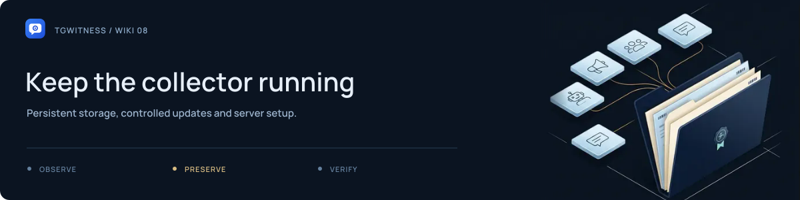

<picture>
  <source media="(max-width: 640px) and (prefers-reduced-motion: reduce)" srcset="../assets/presentation/wiki-server-and-docker-mobile-static.svg">
  <source media="(prefers-reduced-motion: reduce)" srcset="../assets/presentation/wiki-server-and-docker-static.svg">
  <source media="(max-width: 640px)" srcset="../assets/presentation/wiki-server-and-docker-mobile.svg">
  
</picture>

# Server and Docker

**04 · RUN AND PROTECT** · [All guides](Home.md) · [Get help](../../.github/SUPPORT.md)

On this page

- [Run with Docker Compose](#run-with-docker-compose)
- [Access through an SSH tunnel](#access-through-an-ssh-tunnel)
- [Add HTTPS](#add-https)
- [Updates and alternatives](#updates-and-alternatives)

Start with one workspace and persistent storage. The panel only listens on localhost, for remote access use HTTPS or an SSH tunnel.

## Run with Docker Compose

From the project directory, with Docker and Compose 2.20+ installed:

~~~sh
docker compose up -d --build --wait
docker compose exec tgwitness cat /data/panel-token.txt
~~~

Open **http://127.0.0.1:8787** and paste the token. Data lives in the named volume at `/data`; a native `data/live` doesn't get imported automatically.

Check the service:

~~~sh
docker compose ps
docker compose logs --tail 100 tgwitness
~~~

"Healthy" just means the panel answers. Login, sources and an actual captured message are separate checks.

## Access through an SSH tunnel

Keep the collector bound to localhost. From your own computer:

~~~sh
ssh -L 8787:127.0.0.1:8787 user@your-server
~~~

Then open the local address while the tunnel is up. Another local port if 8787 is taken.

<picture><source media="(prefers-reduced-motion: reduce)" srcset="../assets/presentation/readme-divider-static.svg"></picture>

## Add HTTPS

You need a domain pointing at the server and ports 80/443 open. Copy `deploy/env.example` to `.env` and set:

~~~dotenv
TGWITNESS_DOMAIN=watch.your-domain.org
~~~

Then run:

~~~sh
docker compose -f compose.yaml -f deploy/compose/compose.https.yaml up -d --build --wait
docker compose -f compose.yaml -f deploy/compose/compose.https.yaml exec tgwitness cat /data/panel-token.txt
~~~

Open `https://watch.your-domain.org`. Keep passing both `-f` files for status, logs, stop and
updates. Caddy gets and renews the certificate on its own volume.

## Updates and alternatives

Full backup with everything stopped before updating. Keep the project name, volume, config
and external vault key. **Never update with `docker compose down -v`, it deletes the volumes.**

Published images: `deploy/compose/compose.image.yaml`. Native service templates for Linux,
macOS and Windows are in [deploy/](../../deploy/README.md).

**Next:** [Backup and recovery](Backup-and-Recovery.md) · [Deployment reference](../DEPLOYMENT.md) · [Troubleshooting](Troubleshooting.md)
