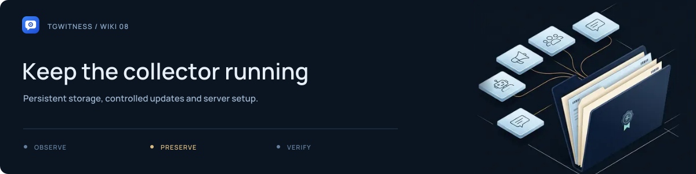

# Server and Docker

[Project](../../README.md) · [Documentation](../README.md) · [Wiki](Home.md) · [Support](../../SUPPORT.md)

Start with one workspace and persistent storage. The default panel binds to localhost; remote access needs HTTPS or an SSH tunnel.

## Run with Docker Compose

From the project directory, with Docker and Compose 2.20+ installed:

~~~sh
docker compose up -d --build --wait
docker compose exec tgwitness cat /data/panel-token.txt
~~~

Open **http://127.0.0.1:8787** and enter the token. The named volume contains the application's data at `/data`. A native installation's `data/live` directory is not automatically imported into that volume.

Check the service:

~~~sh
docker compose ps
docker compose logs --tail 100 tgwitness
~~~

A healthy container confirms the panel responds. Confirm Telegram authorization, source selection and a newly captured message separately.

## Access through an SSH tunnel

Keep the collector bound to localhost. From your own computer:

~~~sh
ssh -L 8787:127.0.0.1:8787 user@your-server
~~~

Open the local panel address while the tunnel is connected. Substitute your SSH user and server. Use another local port if 8787 is already occupied.

## Add HTTPS

Use a domain you control, DNS pointing to the server, and available inbound ports 80 and 443. Copy `.env.example` to `.env` and set:

~~~dotenv
TGWITNESS_DOMAIN=watch.your-domain.org
~~~

Then run:

~~~sh
docker compose -f compose.yaml -f compose.https.yaml up -d --build --wait
docker compose -f compose.yaml -f compose.https.yaml exec tgwitness cat /data/panel-token.txt
~~~

Open `https://watch.your-domain.org`. Keep both Compose file arguments for later status, logs, stop and update commands. Caddy obtains and renews the certificate; its state has a separate persistent volume.

## Updates and alternatives

Make a complete stopped backup before updating. Preserve the project name, data volume, configuration and external master key if used. **Do not use `docker compose down -v` to update: it removes named volumes.**

Published images can use `compose.image.yaml` once the corresponding release image exists. Native service templates are available for Linux, macOS and Windows in the [deployment templates](../../deploy/README.md).

**Next:** [Backup and recovery](Backup-and-Recovery.md) · [Deployment reference](../DEPLOYMENT.md) · [Troubleshooting](Troubleshooting.md)
