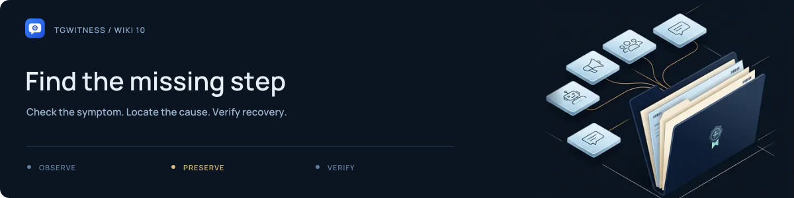

# Troubleshooting

[Project](../../README.md) · [Documentation](../README.md) · [Wiki](Home.md) · [Support](../../.github/SUPPORT.md)

Record the installation method, version, affected workspace and exact step before changing settings. Use a controlled test chat to check recovery.

## Find the failing step

| Symptom | Check | Next action |
| --- | --- | --- |
| Panel does not open | Process output, selected port, container status | Run the local readiness check; confirm no other instance owns the port |
| Token is rejected | Live/demo directory, native/Docker installation, complete token | Read the token from the active installation; they use separate storage |
| Connection test fails | Proxy host, port, kind and compatible secret | Save a corrected route and test it before signing in |
| QR expires | Current workspace and current QR attempt | Request a fresh code and approve it in the intended Telegram account |
| Imported JSON does not log in | Whether it contains authorization or only metadata | Use a supported session companion or phone/QR login |
| Connected, but no new messages | Account ID, source access, scope, exclusions, selected events, observation state | Send a controlled new message after observation starts |
| Deleted message has no saved text | Whether it was captured before deletion | Report that the prior content is unknown; a deletion notice cannot restore it |
| Attachment is queued or missing | Collector running, type/size policy, disk space, media failure record | Resolve the cause and check the final receipt; queued does not mean saved |
| Export cannot be saved in the browser | Browser streaming support and size | Use the authenticated download CLI, then verify the signed archive |
| Verification fails | Correct trusted fingerprint, complete file, password wrapper | Preserve the original files; do not rewrite the journal to make the check pass |
| Witness polls but no post appears | Publication policy, bot/channel rights and witness log | Check actual channel delivery; last-poll time alone does not prove a post |
| Workspace says Deletion incomplete | Other programs holding its files | Close them and retry Delete; the workspace stays stopped |

## Check local prerequisites

From a source installation:

~~~sh
python start.py --check --json
~~~

If the environment has not been created, run `python start.py --setup-only`. A busy port may belong to an existing collector. Use a different `--port` for the check instead of stopping an unrelated process.

For Docker:

~~~sh
docker compose ps
docker compose logs --tail 100 tgwitness
~~~

Add the same `-f` options used when starting an overlay deployment.

<picture><source media="(prefers-reduced-motion: reduce)" srcset="../assets/presentation/readme-divider-static.svg"></picture>

## Telegram asks for a pause

Allow the reported FloodWait interval to expire. Check the account's backoff status and reduce unnecessary snapshots or repeated actions. Repeated login attempts and multiple copies of one authorization are not a recovery strategy.

## Uncertain action result

If a send, join or bot action has an unknown outcome, inspect the chat and its action receipt before retrying. A timeout does not prove Telegram rejected the action.

<picture><source media="(prefers-reduced-motion: reduce)" srcset="../assets/presentation/readme-divider-static.svg"></picture>

## Still stuck?

Follow [Get help](../../.github/SUPPORT.md). Include redacted errors and a synthetic reproduction. Never attach a data directory, session, token, private key or real evidence archive. Send vulnerability reports through the [security process](../../.github/SECURITY.md).

**Related:** [Account troubleshooting](../ACCOUNTS.md) · [Operations](../OPERATIONS.md) · [FAQ](FAQ.md)
