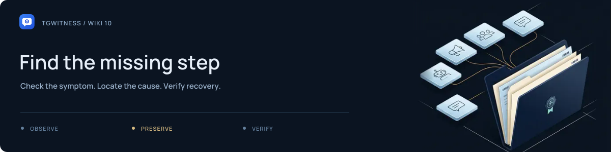

<picture>
  <source media="(max-width: 640px) and (prefers-reduced-motion: reduce)" srcset="../assets/presentation/wiki-troubleshooting-mobile-static.svg">
  <source media="(prefers-reduced-motion: reduce)" srcset="../assets/presentation/wiki-troubleshooting-static.svg">
  <source media="(max-width: 640px)" srcset="../assets/presentation/wiki-troubleshooting-mobile.svg">
  
</picture>

# Troubleshooting

**05 · FIND AN ANSWER** · [All guides](Home.md) · [Get help](../../.github/SUPPORT.md)

On this page

- [Find the failing step](#find-the-failing-step)
- [Check local prerequisites](#check-local-prerequisites)
- [Telegram asks for a pause](#telegram-asks-for-a-pause)
- [Uncertain action result](#uncertain-action-result)
- [Still stuck?](#still-stuck)

Before you touch settings, write down how it's installed, the version, which workspace and
the exact step. Test fixes in a chat you control.

## Find the failing step

| Symptom | Look at | Then |
| --- | --- | --- |
| Panel won't open | Process output, port, container status | Run the readiness check, make sure nothing else holds the port |
| Token rejected | Live vs demo, native vs Docker, whole token copied | Take the token from the install you're actually using |
| Connection test fails | Proxy host, port, type, secret | Fix the route and test before signing in |
| QR expires | Right workspace, latest QR | Get a new code and approve it in the right account |
| Imported JSON won't log in | Does it have a session or just metadata | Use the session file or phone/QR |
| Connected but nothing new | Account ID, access, scope, exclusions, events, observation on | Send a fresh message after starting |
| Deleted message has no text | Was it saved before deletion | Then the text is unknown, nothing can restore it |
| Attachment queued or missing | Collector running, type/size policy, disk, failure record | Fix it and check the receipt, queued isn't saved |
| Browser can't save the export | Streaming support, size | Use the download CLI, then verify |
| Verification fails | Right fingerprint, complete file, password wrapper | Keep the originals, never "fix" the journal |
| Witness polls but doesn't post | Post policy, bot/channel rights, witness log | Check the channel itself |
| Deletion incomplete | Programs holding its files | Close them, retry Delete |

## Check local prerequisites

From a source installation:

~~~sh
python start.py --check --json
~~~

No environment yet? `python start.py --setup-only`. A busy port might be your own running
collector, use another `--port` for the check instead of killing things.

For Docker:

~~~sh
docker compose ps
docker compose logs --tail 100 tgwitness
~~~

Add the same `-f` options used when starting an overlay deployment.

<picture><source media="(prefers-reduced-motion: reduce)" srcset="../assets/presentation/readme-divider-static.svg"></picture>

## Telegram asks for a pause

Wait out the FloodWait. Cut down on snapshots and repeated actions. Logging in again and
again or running copies of the same session only makes it worse.

## Uncertain action result

Unknown result for a send, join or bot press? Look at the chat and the receipt before
retrying. A timeout doesn't mean Telegram said no.

<picture><source media="(prefers-reduced-motion: reduce)" srcset="../assets/presentation/readme-divider-static.svg"></picture>

## Still stuck?

See [Get help](../../.github/SUPPORT.md). Send redacted errors and a repro with fake data.
Never attach a data directory, session, token, key or real evidence. Vulnerabilities go
through the [security process](../../.github/SECURITY.md).

**Related:** [Account troubleshooting](../ACCOUNTS.md) · [Operations](../OPERATIONS.md) · [FAQ](FAQ.md)
