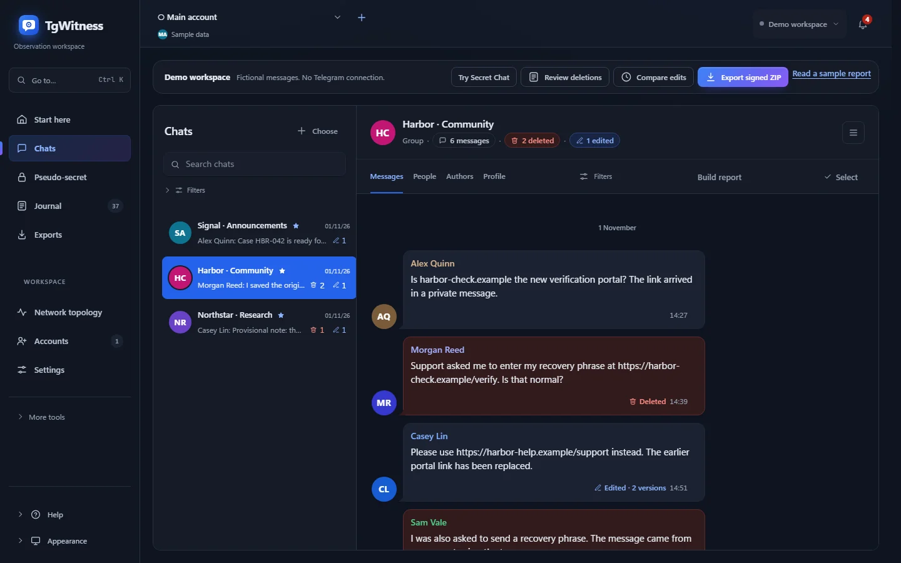
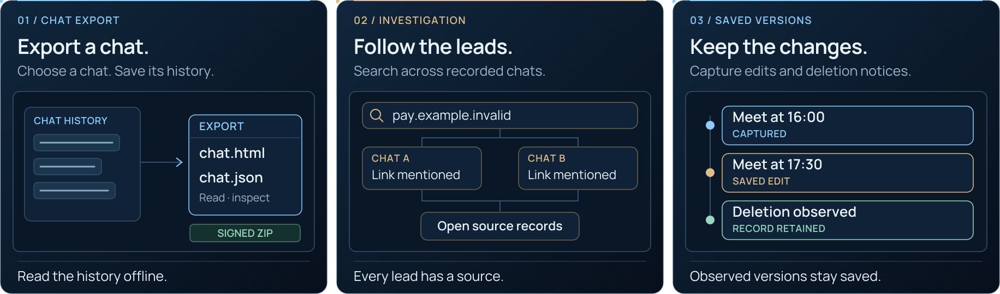
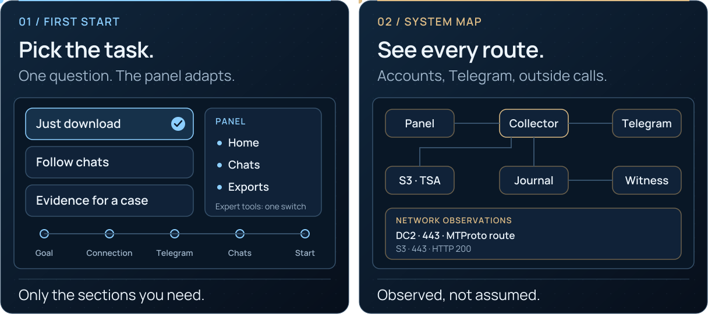
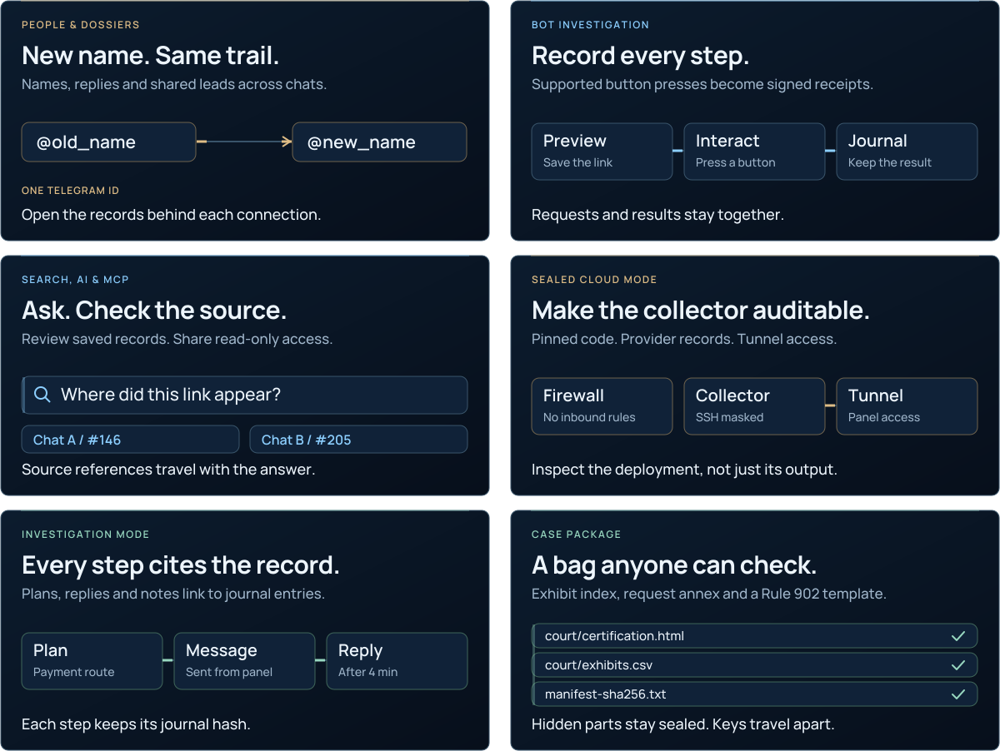
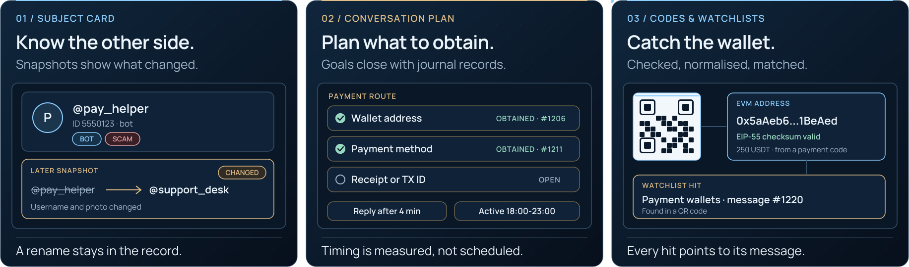
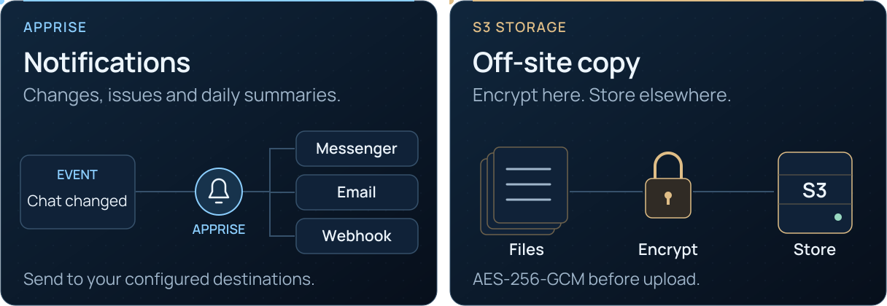

<p align="right"><sub><a href="../../README.md">English</a> · <a href="#languages">其他语言</a></sub></p>

<picture>
  <source media="(max-width: 640px) and (prefers-reduced-motion: reduce)" srcset="../assets/presentation/casework-hero-mobile-static.svg">
  <source media="(prefers-reduced-motion: reduce)" srcset="../assets/presentation/casework-hero-static.svg">
  <source media="(max-width: 640px)" srcset="../assets/presentation/casework-hero-mobile.svg">
  
</picture>

<table>
<tr>
<td width="33%" align="center"><a href="https://phishdestroy.github.io/TgWitness/demo/?lang=zh"><b>浏览演示&nbsp;↗</b></a><br><sub>真实界面，虚构记录</sub></td>
<td width="33%" align="center"><a href="#quick-start"><b>下载并启动&nbsp;↓</b></a><br><sub>一条命令，适用于 Linux、macOS 和 Windows</sub></td>
<td width="33%" align="center"><a href="https://github.com/phishdestroy/TgWitness/wiki"><b>阅读手册&nbsp;↗</b></a><br><sub>分步讲解的调查指南</sub></td>
</tr>
</table>

<p align="center"><strong>自托管的 Telegram 调查工作区。</strong><br>保存聊天，留存编辑和删除，查看谁与谁有关联，<br>并交付任何人都能核验的签名导出文件。</p>

<p align="center"><strong>零信任。</strong>TgWitness 不偏袒任何一方：同样的检查适用于操作员、PhishDestroy 以及其他任何人。<br>只有第三方或数学能够证实的内容才算数。<a href="../QUESTIONS-AND-CHECKS.md">问题与核查</a></p>

<p align="center">
  <a href="../CHANGELOG.md"></a>
  <a href="../../LICENSE"></a><br>
  <sub><a href="../VERIFICATION.md">已测试的环境</a> · 25 种界面语言 · 26 种指南语言</sub>
</p>

<a name="screenshots"></a>

<a href="https://phishdestroy.github.io/TgWitness/demo/?lang=zh">
<picture>
  <source media="(max-width: 640px) and (prefers-reduced-motion: reduce)" srcset="../assets/presentation/readme-workspace-mobile-dark-still.webp">
  <source media="(prefers-reduced-motion: reduce)" srcset="../assets/presentation/readme-workspace-dark-still.webp">
  <source media="(max-width: 640px)" srcset="../assets/presentation/readme-workspace-mobile-dark.webp">
  
</picture>
</a>

<p align="center"><sub>用虚构记录体验真实界面。点击工作区即可试用。</sub></p>

## TgWitness 能做什么

<table>
<tr>
<td width="33%" valign="top"><b><a href="../COLLECTION.md">每次编辑和删除都有留存</a></b><br><sub>消息的每个版本都会保存，收到删除通知后其文本依然保留。</sub></td>
<td width="33%" valign="top"><b><a href="../wiki/Exports-and-Verification.md">人人可核验的证明</a></b><br><sub>签名的哈希链式记录。接收方只需一条命令即可离线验证存档。</sub></td>
<td width="33%" valign="top"><b><a href="../EVIDENCE.md#where-the-messages-come-from">可以证明的来源</a></b><br><sub>通过账户经过认证的 MTProto 会话接收，到达时即签名；GitHub Actions 和 Intel TDX 还会附加证明。</sub></td>
</tr>
<tr>
<td width="33%" valign="top"><b><a href="../EXPORT-BENCHMARK-2026-11-06.md">大规模实测</a></b><br><sub>48 个已验证存档，共 3,598,381 条记录；八个账户以 687.5 条记录/秒的速度获取了 768,007 条历史记录。</sub></td>
<td width="33%" valign="top"><b><a href="../INVESTIGATION-MODE.md">专为调查打造</a></b><br><sub>覆盖文本、二维码和 OCR 的监控列表，钱包检查，对象卡片，案件看板和法庭材料包。</sub></td>
<td width="33%" valign="top"><b><a href="../SECURITY-MODEL.md">由您自己运行</a></b><br><sub>自托管，无遥测。会话保存在加密保险库中；面板监听 localhost。</sub></td>
</tr>
</table>

<p align="center"><sub>开发和测试历时约六个月：首先是收集器、签名日志和验证器，随后是控制面板和附加模块。此代码库于2026年10月29日创建以供发布，因此其创建时间不代表项目的开发时长。</sub></p>

<p align="center"><picture><source media="(prefers-reduced-motion: reduce)" srcset="../assets/presentation/readme-divider-static.svg"></picture></p>

<a name="quick-start"></a>
<a name="run-it-on-your-machine"></a>

## 安装

自带 Python。更新时运行相同的命令即可。

**Linux / macOS**

```sh
curl -fsSL https://get.destroy.tools/install.sh | bash
```

**Windows · PowerShell 或 CMD**

```powershell
powershell.exe -NoProfile -ExecutionPolicy Bypass -Command "irm https://get.destroy.tools/install.ps1 | iex"
```

<sub>Ubuntu 服务器：以 root 身份运行。桌面系统：以普通用户身份运行。`-ExecutionPolicy Bypass` 仅作用于这一个 PowerShell 进程。</sub>

签名构建来自公开的 [Installer 工作流](../../.github/workflows/installer.yml)，安装程序会在安装前检查每个软件包的 SHA-256 和 RSA 签名。

[先验证脚本](../INSTALLATION.md#verify-before-running) · [首次设置](../SETTINGS.md) · [发行版](https://github.com/phishdestroy/TgWitness/releases) · [Docker](DEPLOYMENT.md)

<details>
<summary><strong>安装程序与您的数据如何受到保护</strong></summary>

`get.destroy.tools` 是本项目的下载站点。公开的 [Installer 工作流](../../.github/workflows/installer.yml)针对确切的 `main` 修订版本，从 [`deploy/installer/`](../../deploy/installer/README.md) 构建该站点，在 Linux 和 Windows 安装测试通过后发布，并使用 [`release-signing.pub`](../../deploy/installer/release-signing.pub) 中的发布密钥为安装脚本和应用程序包签名。安装程序在安装前会检查软件包及依赖锁定文件的 SHA-256 和 RSA 签名。如需先检查脚本本身，请将脚本连同签名一起下载，然后运行[先验证命令](../INSTALLATION.md#verify-before-running)。构建失败时，原有下载内容保持不变；重新运行安装程序即可更新已安装的面板。GitHub [发行版](https://github.com/phishdestroy/TgWitness/releases)、源代码和 [Docker](DEPLOYMENT.md) 是另外几种安装方式。

**您的会话与数据。** TgWitness 运行在您的计算机或服务器上，面板默认监听 localhost。Telegram 会话、代理凭据和访问令牌哈希存储在每个工作区的加密保险库中，还可选用[外部主密钥](../SECURITY-MODEL.md#external-master-key)。应用程序没有遥测功能。它会连接 Telegram 以及设置中所用的服务：公共 MTProxy 列表、您的代理、S3 存储、见证机器人、时间戳机构、AI 服务商和 webhook。[系统图](../SYSTEM-MAP.md)列出了应用程序进程建立的连接。请使用[专用 Telegram 账户](https://phishdestroy.github.io/TgWitness/zh/docs/dedicated-account/)进行观察。

版本徽章描述的是此源代码树。可安装的构建列在[发行版](https://github.com/phishdestroy/TgWitness/releases)中；合并到 `main` 的功能会随下一个版本进入这些下载。

[设置与面板访问](../INSTALLATION.md) ·
[签名与 SHA-256](https://get.destroy.tools/#verification) ·
[更新](../INSTALLATION.md#update-an-existing-installation) ·
[当前功能与鉴定状态](../STATUS.md) ·
[选择采集方法](../COLLECTION-MODES.md)

</details>

<p align="center"><picture><source media="(prefers-reduced-motion: reduce)" srcset="../assets/presentation/readme-divider-static.svg"></picture></p>

<a name="how-it-works"></a>

## 他人可以核验的记录

无需账户，也无需安装即可核验。公开的示例自带验证器：

```sh
curl -LO https://phishdestroy.github.io/TgWitness/demo/downloads/tgwitness-demo.zip
unzip -o tgwitness-demo.zip verify.py        # 验证器就包含在存档中
python verify.py tgwitness-demo.zip          # Python 3.11+，只需要 `cryptography`
```

它会输出签名记录、最新记录的哈希值和签名者指纹，并以 `0` 退出。示例为虚构内容；同一个验证器适用于任何真实导出。

导出包含消息、文件和验证器。通过另一个渠道把您的密钥指纹发给接收方，对方即可自行核验：

```sh
python -m tgwitness.verify evidence.zip --fingerprint TRUSTED_SHA256 --tsa-ca TSA-ROOT.pem --require evidence
```

验证器会检查签名、日志链、文件清单和附件。若要达到证据级别，它还需要您的密钥指纹，以及覆盖最后一条记录的第三方时间戳，例如对照时间戳机构根证书校验的 RFC 3161 时间戳。

**消息从何而来。** TgWitness 像官方应用一样，通过账户的加密 MTProto 会话从 Telegram 接收消息，并在每条消息到达时将其签名写入日志。[GitHub Actions 捕获](../SEALED-ACTIONS.md)和 [Phala Intel TDX](../HIGH-ASSURANCE.md) 还会为接收这些消息的收集器提供证明。

<picture>
  <source media="(max-width: 640px) and (prefers-reduced-motion: reduce)" srcset="../assets/presentation/casework-chain-mobile-static.svg">
  <source media="(prefers-reduced-motion: reduce)" srcset="../assets/presentation/casework-chain-static.svg">
  <source media="(max-width: 640px)" srcset="../assets/presentation/casework-chain-mobile.svg">
  
</picture>

[存档验证](../wiki/Exports-and-Verification.md) · [证据格式](../EVIDENCE.md) · [独立见证人](../WITNESS.md) · [外部时间戳](../TIMESTAMP.md) · [检查项与测试规模](../VERIFICATION.md)

<p align="center"><picture><source media="(prefers-reduced-motion: reduce)" srcset="../assets/presentation/readme-divider-static.svg"></picture></p>

## 从一段对话到一个案件

<picture>
  <source media="(max-width: 640px) and (prefers-reduced-motion: reduce)" srcset="../assets/presentation/readme-features-mobile-static.svg">
  <source media="(prefers-reduced-motion: reduce)" srcset="../assets/presentation/readme-features-static.svg">
  <source media="(max-width: 640px)" srcset="../assets/presentation/readme-features-mobile.svg">
  
</picture>

<table>
<tr>
<td width="33%" align="center"><a href="../wiki/Chat-Export.md"><b>聊天导出&nbsp;↗</b></a><br><sub>把一个聊天导出为签名的 HTML 和 JSON</sub></td>
<td width="33%" align="center"><a href="../INVESTIGATION.md"><b>调查&nbsp;↗</b></a><br><sub>在已记录的聊天中追踪线索</sub></td>
<td width="33%" align="center"><a href="../COLLECTION.md"><b>保存的版本&nbsp;↗</b></a><br><sub>编辑和删除通知都会保留</sub></td>
</tr>
</table>

两种用法：一次性[导出您的账户](../ACCOUNT-EXPORT.md)，或者[跟进一项调查](../INVESTIGATION.md)并持续保存变化。可以选择几个聊天、一个 Telegram 文件夹或整个账户。每个账户都有自己的工作区、会话和签名密钥。

<p align="center"><picture><source media="(prefers-reduced-motion: reduce)" srcset="../assets/presentation/readme-divider-static.svg"></picture></p>

## 了解更多

<details>
<summary><strong>导出实测 · 2026 年 11 月 6 日</strong> · 56,329 条消息，两个存档均已通过验证</summary>

**两次全新运行共导出 56,329 条消息。** 两个签名存档均已使用固定的收集器密钥通过验证。

[](https://phishdestroy.github.io/TgWitness/zh/docs/validation/)

| 运行 | 消息数 | 采集时间 | 采集速度 | 完整导出 | 端到端速度 |
| --- | ---: | ---: | ---: | ---: | ---: |
| 服务器 A | 27,030 | 189.043 秒 | **142.983 条消息/秒** | 211.647 秒 | 127.713 条消息/秒 |
| 服务器 B | 29,299 | 182.513 秒 | **160.531 条消息/秒** | 206.650 秒 | 141.781 条消息/秒 |

通过 WARP 传输文本和元数据，每台服务器两个账户，不含附件，也没有复用的记录。测量基于修订版本 [`92e539af`](https://github.com/phishdestroy/TgWitness/commit/92e539af40d8368d198ff5e040f1d876f2c1310e)。每次公布的运行都列出了源代码修订版本、工作负载、耗时和验证结果：[工作负载、耗时与验证](../EXPORT-BENCHMARK-2026-11-06.md)。对 `main` 的更改会运行公开的 [CI 工作流](../../.github/workflows/README.md)，其中包括 Linux 和 Windows 安装程序测试以及独立验证器的构建。

[**浏览演示 →**](https://phishdestroy.github.io/TgWitness/demo/?lang=zh) ·
[**测量数据、日期与方法 →**](https://phishdestroy.github.io/TgWitness/zh/docs/validation/) ·
[下载虚构的示例导出](https://phishdestroy.github.io/TgWitness/demo/downloads/tgwitness-demo.zip) ·
[签名的英文审计报告](../../website/validation/audit/REPORT.md)

</details>

<a name="start-simple"></a>

<details>
<summary><strong>从简单开始，看清每条路径。</strong> · 首次启动与系统图</summary>

<picture>
  <source media="(max-width: 640px) and (prefers-reduced-motion: reduce)" srcset="../assets/presentation/readme-start-map-mobile-static.svg">
  <source media="(prefers-reduced-motion: reduce)" srcset="../assets/presentation/readme-start-map-static.svg">
  <source media="(max-width: 640px)" srcset="../assets/presentation/readme-start-map-mobile.svg">
  
</picture>

首次启动只问一个问题：**仅下载**、**关注聊天**还是**案件的证据**。答案决定目标和界面级别，面板只显示该任务所需的部分。随后分五个阶段完成连接、Telegram 登录和聊天选择。连接检查会自动运行，只有检查失败时才会出现路由选项。专家工具只需拨动一个开关即可打开。

**系统图**展示安装如何连接 Telegram 和外部服务：面板访问、每个账户的路由和 Telegram 目标、日志与见证人路径，以及最新的网络观测记录。缺失的观测记录会标注为缺失。

[首次设置](../SETTINGS.md) · [系统图](../SYSTEM-MAP.md)

</details>

<details>
<summary><strong>覆盖调查的其余环节</strong> · 对象卡片、监控列表、钱包、在线状态监测、法庭文件</summary>

<picture>
  <source media="(max-width: 640px) and (prefers-reduced-motion: reduce)" srcset="../assets/presentation/readme-capabilities-mobile-static.svg">
  <source media="(prefers-reduced-motion: reduce)" srcset="../assets/presentation/readme-capabilities-static.svg">
  <source media="(max-width: 640px)" srcset="../assets/presentation/readme-capabilities-mobile.svg">
  
</picture>

<table>
<tr>
<td width="50%" align="center"><a href="../INVESTIGATION.md#4-connect-observations-across-chats"><b>人物与档案&nbsp;↗</b></a><br><sub>按 Telegram ID 追踪名称和用户名</sub></td>
<td width="50%" align="center"><a href="../COLLECTION.md#act-from-the-panel"><b>机器人调查&nbsp;↗</b></a><br><sub>带签名回执的机器人交互</sub></td>
</tr>
<tr>
<td width="50%" align="center"><a href="https://phishdestroy.github.io/TgWitness/zh/docs/archive/"><b>存档搜索、AI 与 MCP&nbsp;↗</b></a><br><sub>搜索存档，连接只读客户端</sub></td>
<td width="50%" align="center"><a href="../HIGH-ASSURANCE.md"><b>密封云部署&nbsp;↗</b></a><br><sub>运行在 Intel TDX 中的收集器</sub></td>
</tr>
</table>

<picture>
  <source media="(max-width: 640px) and (prefers-reduced-motion: reduce)" srcset="../assets/presentation/readme-documentation-mobile-static.svg">
  <source media="(prefers-reduced-motion: reduce)" srcset="../assets/presentation/readme-documentation-static.svg">
  <source media="(max-width: 640px)" srcset="../assets/presentation/readme-documentation-mobile.svg">
  
</picture>

**记录对话。** 在**文档**抽屉中为某个聊天开始记录后，每一步都会自动写入：面板操作、回复及回复前的延迟、编辑、删除通知、备注和 AI 草稿。每一步都会引用对应的日志记录及其 SHA-256。定稿时，文档会被签名，声明哈希会写入日志。

| | |
| --- | --- |
| [对象卡片](../INVESTIGATION-MODE.md#subject-cards) | 机器人、个人、频道或群组的资料快照，带有 Telegram 的 BOT、VERIFIED、SCAM 和 FAKE 标签；后续快照会列出变化之处 |
| [对话计划](../INVESTIGATION-MODE.md#conversation-plans) | 针对付款路径、基础设施或相关人员的目标，预先准备的消息，回复时间，按小时统计的活跃度，以及对方的写作风格 |
| [翻译](../INVESTIGATION-MODE.md#machine-translation) | 显示在原文下方，并注明语言、模型和日志记录 |
| [监控列表](../INVESTIGATION-MODE.md#watchlists) | 关键词、模式、钱包、@用户名、ID、域名、电话和链接，可在文本、编辑、隐藏的链接目标、机器人按钮、二维码和 OCR 中匹配 |
| [在线状态监测](../INVESTIGATION-MODE.md#online-watch) | 每 1–60 分钟检查一次，每次请求最多 100 个账户，并按小时和星期几给出规律 |
| [二维码与钱包](../INVESTIGATION-MODE.md#codes-in-images) | 付款二维码；按 EIP-55 校验的 EVM 地址、原始格式的 TON 地址、XRP Ledger 校验和，以及包含链、金额和代币的付款链接 |
| [客户端痕迹](../INVESTIGATION-MODE.md#what-a-client-and-an-upload-time-show) | 圆形视频和语音消息中的编码器痕迹；对比上传时间与发送时间，可以揭穿预先录制的“实时”证明 |
| [掩护身份与授权](../INVESTIGATION-MODE.md#cover-and-authority) | 人设、授权，以及卧底活动记录，后者会标记授权聊天范围或授权期限之外的消息 |
| [账户控制](../INVESTIGATION-MODE.md#account-control) | 编辑资料和隐私设置并留下修改前后的记录，进行暴露检查，每次操作后立即离线 |
| [法庭文件](../INVESTIGATION-MODE.md#documents-for-court) | BagIt 案件包，附 Rule 902(13)/(14) 认证模板、证物索引、请求附件以及屏幕录像的 WebVTT/SRT 字幕 |

标记为 18+、暴力或个人数据的内容保留在法庭副本中，以 AES-256-GCM 密封；密钥单独传递。

[导出设置](../EXPORT_HASHES.md)涵盖常规 API 与 Takeout 获取方式、先获取消息历史再获取附件、下载文件或使用服务器哈希，以及兼容 Telegram Desktop 的 JSON/HTML 视图。[分布式聊天导出](../DISTRIBUTED-EXPORT.md#history-acquisition)为公开历史提供需手动启用的 Takeout 路径、每 100 条消息一个签名检查点，以及使用同一账户在区间内恢复；其[性能设计](../FAST-ACQUISITION.md)列出了已测试的获取行为和计划中的实测。

</details>

<details>
<summary><strong>其他功能</strong> · 历史记录、账户、代理、AI、集成</summary>

| | |
| --- | --- |
| [加载更早的消息](../HISTORY.md) | 拉取所选聊天的历史消息，可随时暂停和继续 |
| [多个账户](../ACCOUNTS.md#multiple-accounts) | 相互独立的工作区，各有自己的 Telegram 会话、日志和签名密钥 |
| [批量导入](../ACCOUNTS.md#bulk-import-and-account-groups) | 一次放入大量会话文件，把账户分组并共享设置 |
| [MTProxy 池](../wiki/Proxies.md#pool-dashboard-and-custom-sources) | Ping 延迟、国家、筛选条件、自定义列表 |
| [已有会话](../ACCOUNTS.md) | TData、Telethon、Pyrogram、StringSession、auth key 或 `key:DC` 行；可选通过导入的供体账户进行独立的二维码授权 |
| [账户安全](../ACCOUNTS.md#create-an-independent-authorization) | 新会话提醒、终止其他会话、同时设置两步验证密码的唯一会话模式，以及[见证探针](../ACCOUNTS.md#witness-probe)：实时更新不再到达此会话时会被察觉 |
| [可续传的聊天导出](../EXPORT_HASHES.md#restricted-github-capture-and-single-chat-export) | 中断的导出会保留一份签名的部分副本：可以继续、重新开始或下载已保存的内容 |
| [代理](../CONNECTION-SECURITY.md#ip-modes) | 每个工作区可使用 SOCKS5、HTTP CONNECT 或 MTProxy。**隐藏 IP** 绝不会回退到直连 |
| [搜索与 AI](../ANALYSIS.md) | 本地搜索，可选的 AI 并附可核查的来源 |
| [全文搜索](../SEARCH.md) | 词形变化、精确短语、域名、@用户名以及无空格的中文，最佳匹配优先（**预览版**） |
| [MCP](../MCP.md) | 为 MCP 客户端提供只读访问，仅限您选择的聊天 |
| [命令行](../CLI.md) | `search`、`context`、`messages`、`stats` 以及 JSON Lines 格式的 `export`，配合 `--json` 供脚本和智能体使用，可在本地运行或使用限定范围的令牌（**预览版**） |
| [OCR 与转录](../MEDIA-ANALYSIS.md) | 在本地运行，原始文件保持不变 |
| [独立捕获](../OPTIONAL-CAPTURE.md) | 可选的浏览器/AyuGram 记录器，位于**更多工具 → 扩展功能**下（预览，默认关闭） |
| [Trusted Live](../TRUSTED-LIVE.md) | 官方 Desktop/Web 会话、受保护的视频录制以及原生导出连续性分析（预览；实测鉴定待完成） |
| [密封的官方 Web](../OFFICIAL-WITNESS.md) | 在 GitHub Actions 上运行全新的官方浏览器，控制受限，视频经过签名，来源和设置有独立给出的预期值 |
| [Webhooks](../WEBHOOKS.md) | 带重试的签名外发事件，附 n8n 示例 |
| [共享访问](../ACCESS.md) | 只向他人开放选定的聊天，并设置有效期和 IP 限制 |
| [缺失的消息编号](../EVIDENCE.md#missing-message-numbers-gap_summary) | Telegram 已分配但从未观察到的编号，按频道和整个账户统计，体现在覆盖率、报告和 MCP 中（**预览版**） |
| [聊天状态快照](../COLLECTION.md) | 定期对标题、简介、置顶消息、管理员和礼物进行签名快照，并列出变化（**预览版**） |
| [系统图](../SYSTEM-MAP.md) | 实时展示面板访问、账户路由、Telegram 目标和外部服务，并显示最多 2,000 条网络观测记录中的最新 200 条 |

</details>

<details>
<summary><strong>选择记录的信任基础</strong> · 本地、经审计的云、GitHub Actions 或 Intel TDX</summary>

可以在本地运行，加上经审计的云端部署，或者在**配备 Intel TDX 的 Phala Cloud 机密虚拟机**中采集。每种方式都会保留签名日志；额外的检查针对的是采集时所在的环境。

<picture>
  <source media="(max-width: 640px) and (prefers-reduced-motion: reduce)" srcset="../assets/presentation/casework-assurance-mobile-static.svg">
  <source media="(prefers-reduced-motion: reduce)" srcset="../assets/presentation/casework-assurance-static.svg">
  <source media="(max-width: 640px)" srcset="../assets/presentation/casework-assurance-mobile.svg">
  
</picture>

TDX 验证器会对照固定的 Intel 根证书和吊销数据检查 quote，将其绑定到签名的收集器声明和新生成的挑战值，并把经度量的操作系统和应用程序与独立确定的预期输入进行比较。报告会分别列出每一项结果，因此可以把经度量的环境、收集器身份、捕获记录和覆盖范围放在一起审查。

**带 GitHub 来源证明的捕获**（预览）。在 GitHub 托管的运行器上，使用固定版本的 TgWitness 和全新的 Telegram 会话采集聊天，然后下载加密存档及其 GitHub 证明。验证器会检查获批的工作流和收集器版本、存档摘要、日志和附件。在面板的**导出**中同样可以使用。[打开捕获页面](https://phishdestroy.github.io/TgWitness/zh/docs/capture/) · [使用说明](../SEALED-ACTIONS.md)

如需实时观察、获取历史或一次性导出，请选择合适的[采集方法](../COLLECTION-MODES.md)。所连接的账户能够访问的私有云聊天均可采集。发布的应用程序还包含 [Secret Chat 集成](../PSEUDO-SECRET.md)：安装可选的协议依赖并按账户启用后，即可记录在该账户中创建或接受的聊天。可用的获取途径见[采集范围](../COLLECTION.md)。

[Phala / Intel TDX 与经审计的部署](../HIGH-ASSURANCE.md) ·
[Phala 线上实测鉴定](../VERIFICATION.md#live-phala-cloud-deployment--4-november-2026) ·
[信任边界](../SECURITY-MODEL.md)

</details>

<a name="manifesto"></a>

<details>
<summary><strong>核验捕获过程与保存的记录</strong> · 接收方验证的内容与 Export Clinic</summary>

<picture>
  <source media="(max-width: 640px)" srcset="../assets/presentation/readme-manifesto-mobile.svg">
  
</picture>

TgWitness 记录投递到所连接 Telegram 账户的内容，包括聊天、消息和发送者标识符、已捕获的版本以及采集元数据。存档把这些记录、保留的附件和验证数据集中在一起，供审查使用。

| 检查项 | 接收方验证的内容 |
| --- | --- |
| 签名日志与清单 | 对照预期的签名密钥，验证记录签名、哈希链和交付的文件。 |
| 单独保存的检查点 | 对照先前记录的长度和最新记录的哈希值验证日志。 |
| 独立见证人 | 对照另一方见证人保存的检查点验证日志。 |
| GitHub Actions 捕获 | 对照存档的证明、获批的托管工作流和收集器版本验证存档。 |

[Export Clinic](https://phishdestroy.github.io/TgWitness/docs/export-clinic/) 将一段 Telegram 对话与经过刻意篡改的 Desktop 导出文件并排展示。您可以对比各个版本、查看改动之处，并按步骤了解签名 TgWitness 存档的采集与验证过程。

[验证步骤](../wiki/Exports-and-Verification.md) ·
[GitHub 捕获](../SEALED-ACTIONS.md) ·
[技术信任模型](../SECURITY-MODEL.md)

</details>

<a name="operations"></a>

<details>
<summary><strong>让调查持续运转</strong> · 通知、存储与恢复</summary>

<picture>
  <source media="(max-width: 640px) and (prefers-reduced-motion: reduce)" srcset="../assets/presentation/readme-services-mobile-static.svg">
  <source media="(prefers-reduced-motion: reduce)" srcset="../assets/presentation/readme-services-static.svg">
  <source media="(max-width: 640px)" srcset="../assets/presentation/readme-services-mobile.svg">
  
</picture>

[通知](../OPERATIONS.md#notifications) · [加密的异地副本](../wiki/Off-site-Copy.md) · [备份与恢复](../wiki/Backup-and-Recovery.md) · [故障排除](../OPERATIONS.md)

<table>
<tr>
<td width="33%" align="center"><a href="https://phishdestroy.github.io/TgWitness/zh/docs/start/"><b>设置指南&nbsp;↗</b></a><br><sub>从安装到第一个聊天</sub></td>
<td width="33%" align="center"><a href="https://phishdestroy.github.io/TgWitness/zh/docs/dedicated-account/"><b>准备账户&nbsp;↗</b></a><br><sub>专用的 Telegram 账户</sub></td>
<td width="33%" align="center"><a href="DEPLOYMENT.md"><b>Docker 与服务器&nbsp;↗</b></a><br><sub>HTTPS、重启与更新</sub></td>
</tr>
</table>

</details>

<a name="repository-map"></a>

<details>
<summary><strong>浏览代码仓库</strong> · 代码、文档和工具的位置</summary>

| 目录 | 从这里开始 |
| --- | --- |
| [docs/](../README.md) | 设置、调查工作流程和技术参考 |
| [tgwitness/](../../tgwitness/README.md) | 主应用程序、收集器、日志和 Web 面板 |
| [tgwitness_capture/](../../tgwitness_capture/README.md) | 独立记录器及其验证代码 |
| [addons/](../../addons/README.md) | 可选捕获功能的安装、配置和测试 |
| [deploy/](../../deploy/README.md) | 安装程序、容器和后台服务 |
| [examples/](../../examples/README.md) | 账户导出和密封捕获的配置 |
| [integrations/](../../integrations/README.md) | 签名 webhook 和 n8n 接收端 |
| [.agents/](../../.agents/README.md) | 通过 CLI 读取存档的任务说明 |
| [scripts/](../../scripts/README.md) | 启动器和 CI 工具 |
| [tools/](../../tools/README.md) | 构建、检查和打包 |
| [website/](../../website/README.md) | 公开网站、翻译版指南和交互式演示 |
| [.github/](../../.github/AUTOMATION.md) | 工作流、贡献指南和支持 |

[完整项目指南](../PROJECT-GUIDE.md) ·
[参与贡献](../../.github/CONTRIBUTING.md) · [获取帮助](../../.github/SUPPORT.md)

</details>

<details>
<summary><strong>⚖️ 道德声明与历史延续性</strong></summary>

作者立场声明和操作员声明的中文版本：

[操作员声明](OPERATOR-INCOMPATIBILITY.md) · [MIT 许可证](../../LICENSE) · [原始 NOTICE](../../NOTICE)

</details>

<a name="languages"></a>

<details>
<summary><strong>用您的语言阅读项目概览</strong></summary>

[English](../../README.md) · [Русский](../ru/README.md) · [Українська](../uk/README.md) · [Español](../es/README.md) · [Português (Brasil)](../pt/README.md) · [Türkçe](../tr/README.md) · [العربية](../ar/README.md) · [فارسی](../fa/README.md) · [اردو](../ur/README.md) · [हिन्दी](../hi/README.md) · [Bahasa Indonesia](../id/README.md) · [Tiếng Việt](../vi/README.md) · **简体中文** · [繁體中文](../zh-Hant/README.md) · [Français](../fr/README.md) · [Deutsch](../de/README.md) · [Italiano](../it/README.md) · [Polski](../pl/README.md) · [O‘zbekcha](../uz/README.md) · [한국어](../ko/README.md) · [日本語](../ja/README.md) · [Bahasa Melayu](../ms/README.md) · [ไทย](../th/README.md) · [עברית](../he/README.md) · [বাংলা](../bn/README.md) · [አማርኛ](../am/README.md)

</details>

<p align="center">
  <a href="../README.md"><b>技术文档</b></a> ·
  <a href="https://github.com/phishdestroy/TgWitness/wiki"><b>调查手册</b></a> ·
  <a href="https://github.com/phishdestroy"><b>由 PhishDestroy 打造</b></a> ·
  <a href="../../.github/CONTRIBUTING.md"><b>参与贡献</b></a> ·
  <a href="../../.github/SUPPORT.md"><b>获取帮助</b></a> ·
  <a href="../../.github/SECURITY.md"><b>报告漏洞</b></a>
</p>

[机器可读的项目索引](../../llms.txt) · [完整文本手册](https://phishdestroy.github.io/TgWitness/llms-full.txt) · [面向智能体的仓库规则](../../AGENTS.md)
