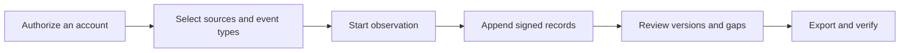

[English](../../README.md) · [Русский](../ru/README.md) · [Українська](../uk/README.md) · [Español](../es/README.md) · [Português (Brasil)](../pt/README.md) · [Türkçe](../tr/README.md) · [العربية](../ar/README.md) · [فارسی](../fa/README.md) · [اردو](../ur/README.md) · [हिन्दी](../hi/README.md) · [Bahasa Indonesia](../id/README.md) · [Tiếng Việt](../vi/README.md) · **简体中文**


<p align="center">
  <strong>您的 Telegram 观察工作区。</strong><br>
  保存捕获的对话记录，了解变化情况，并分享经过数字签名的历史记录。<br>
  在您自己的计算机或服务器上运行，使用您自己的账户。
</p>

<p align="center">
  
  
  
  
  
</p>

<p align="center">
  <a href="#快速入门">快速入门</a> ·
  <a href="#功能">功能</a> ·
  <a href="#连接-telegram-账户">账户</a> ·
  <a href="#证据与验证">证据</a> ·
  <a href="#部署">部署</a> ·
  <a href="../README.md">文档</a>
</p>

> [!TIP]
> **连接前请先探索。**运行 `scripts\Demo.cmd` 或 `sh start.sh --demo` 以打开包含虚构对话的工作区。无需 Telegram 账号。

**初次访问？**[开始 →](QUICKSTART.md) · [维基 →](../wiki/Home.md) · [选择指南 →](../README.md) · [获取帮助 →](../../.github/SUPPORT.md) · [查看已测试内容 →](../VERIFICATION.md)

> [!WARNING]
> **请使用一个可以承受丢失风险的专用 Telegram 账号。**我们强烈建议不要关联个人或重要账号，也不要在这些账号上生成 API ID / API 哈希凭证。Telegram 可能会限制或永久封禁账号。[请阅读账号指南](../ACCOUNTS.md)。

## 功能

- **带有历史记录的对话。**在对话上下文中阅读已保存的消息、比较已捕获的编辑内容，并查看删除通知。
- **按您的方式进行监控。**您可以选择单个聊天、Telegram 文件夹或整个账号。每个账号都有独立的工作区和设置。
- **可供验证的导出文件。**包括经过签名的 ZIP 文件、原始记录、完整保留的附件以及离线 HTML 报告。可选密码保护功能，便于交接。
- **专为日常使用而设计。**支持浅色和深色主题、13种语言、搜索功能、Ctrl/Cmd+K导航，以及直接在聊天界面执行操作。
- **按需使用的附加功能。**[只需三步即可创建 Telegram](../WITNESS.md) 见证，另设独立的[公开证明](../PROOF.md)页面，并配有清晰的设置指南。打开**“附加功能”**进行选择；高级设置则保持折叠状态。

<details>
<summary>所有功能与技术细节</summary>

- **您的连接路径。****在“账户”→“代理设置**”中，可从内置的公共 MTProxy 列表中选择，从源头刷新列表，或粘贴您自己的 Telegram 代理链接。手动配置 SOCKS5/HTTP/MTProxy 以及运营商目录功能依然可用。公共列表已下载并经过筛选，但目前尚无账户通过列表中的服务器建立连接。 [公共列表的工作原理](../CONNECTION-SECURITY.md#public-proxies-supplied-by-your-installation)。

- **记录您的账户实际所见内容。涵盖**您所选群组和频道中的新消息、编辑、删除通知、点赞、成员动态以及覆盖缺口。
- **可选择特定聊天、Telegram 文件夹或整个账户。** 选择要记录的类型——频道、群组、私聊、机器人——新聊天一出现即被添加。排除项、自己的发送消息和编辑操作、与对应聊天匹配的私聊中被删除的内容、优先级重新检查以及按类型（[集合](../COLLECTION.md#observation-scope-chosen-chats-a-folder-or-the-whole-account)）设置的附件限制。
- **调查模式。**一键即可创建专用账户，该账户将加入团队并与机器人进行交互： 该账户所见所发的一切均被记录，机器人消息下的按钮（链接、网页应用、可复制文本）会被保留，仅通过按钮进行的编辑将生成新版本，且每个新聊天或机器人都会立即保存其个人资料（描述、命令、成员）以及此前可见的消息（[调查模式](../COLLECTION.md#investigation-mode-joining-teams-and-talking-to-bots)）。 控制面板中的**《专用账户指南**》（`/dedicated-account.html`）解释了为何不得使用主账户、TgWitness为何通过公共应用哈希/应用 ID 对运行，以及为何 API 对本身并不能授予对您账户的访问权限（附有 Telegram 文档链接），并列出了创建额外账户的方法。
- **可直接在聊天界面中操作。**发送消息和回复、点击机器人回调/文本按钮，或预览 Telegram 邀请并加入。所选账户将执行相应操作；请求、邀请预览以及机器人弹窗/URL 响应将记录在其签名日志中（[面板迷你客户端](../COLLECTION.md#act-from-the-panel)）。
- **可明确说明的覆盖范围。**报告和验证工具应注明“从 X 到 Y 期间持续监测”，并列出监测缺口及其原因，以及从未被监测到的消息 ID——切勿将其表述为已被删除。
- **用户档案，按聊天室选择是否加入。** 姓名和用户名历史记录、Telegram标记、头像的SHA-256和pHash值、活动记录、谁回复了谁以及被提及的钱包、手机号、用户名和链接——仅基于保存的记录构建，每个事实均指向其日志记录，并导出为单独的签名文件（[证据模型](../EVIDENCE.md#people-profiles)）。
- **独立见证机制。**一个拥有独立密钥和机器人的独立进程会获取已签名的日志头，将其发布到 Telegram 频道，并在收集器未响应时发出报告；验证者会根据该日志头核对导出数据。间隔时间、超时设置、发布哪些检查结果以及帖子内容均可通过选项或 JSON 配置文件（[witness](../WITNESS.md)）进行配置。 已针对本地 Bot API 服务器进行测试，尚未在真实机器人和频道上测试。
- **控制面板中的采集设置。**采集限制与频率、复核、下载、用户资料、通知及导出等功能均位于**“参数**”页面，其中包含各设置的范围及默认值；每次更改都会记录在经过数字签名的日志中（[设置与参数](#设置与参数)）。
- **编辑和删除操作均保留上下文记录。**每次编辑都会生成一个独立版本，并与前一个版本并列显示；删除通知绝不会抹去已记录的内容。
- **经过签名且可验证的导出文件。**每个事件均采用哈希链（SHA-256）并经过签名（Ed25519）。签名的 ZIP 包包含 JSONL、CSV、离线 HTML 报告、原始媒体文件以及一个独立验证程序。
- **受密码保护的导出文件。** 可选地将任何导出内容打包为 WinZip AES-256 ZIP 格式，该格式可被 7-Zip 和 WinRAR 读取；其中的签名内容保持不变。在 libarchive（Windows `tar`）中逐字节打开了一个测试压缩包，输入错误密码时会被拒绝（[证据模型](../EVIDENCE.md#investigation-handoff)）。
- **通知。** 问题（磁盘空间不足、账户已注销、收集器、复制或时间戳错误）、被监视聊天群组中的变化以及每日摘要，将通过 [Apprise](https://github.com/caronc/apprise) 发送至 Matrix、Telegram、Discord、Slack、ntfy、电子邮件及许多其他服务——除非您开启摘要功能，否则不包含消息正文——并在面板中列出。 已针对本地端点测试过消息发送功能；各服务本身尚未经过测试。
- **支持 13 种界面语言：**英语、俄语、乌克兰语、西班牙语、葡萄牙语（巴西）、土耳其语、阿拉伯语、波斯语、乌尔都语、印地语、印尼语、越南语和简体中文，均通过 DeepL 进行机器翻译。较新的章节使用明确标注的英语备用文本；迷你客户端的控件仍保持为英语。 Telegram 内容和日志记录始终以保存时的原貌显示。
- **浅色和深色主题。**默认遵循系统设置；每个浏览器的选择都会被记住。
- **支持键盘导航。**按 **Ctrl+K**（Mac：**⌘K**）或选择**“转到…”**以查找章节。使用方向键和 Enter 键打开该章节；按 Escape 键关闭菜单。
- **多账户支持。**可创建任意数量的隔离工作区，每个工作区均拥有独立的 Telegram 会话、日志、签名密钥、代理路由及数据捕获策略。
- **灵活的登录方式。**手机号码 + 验证码 + 双因素认证（2FA）、二维码、Telethon/Pyrogram `.session`、Telegram Desktop TData ZIP、Telethon StringSession，或包含其 DC ID 的完整认证密钥。
- **按账户设置代理。**支持 SOCKS5 和 HTTP CONNECT，已通过本地测试代理验证，并支持实验性的 MTProxy，但尚未在真实服务器上进行测试。代理连接失败时，系统绝不会默认回退到直接连接。
- **设计上即为私有。**在您的计算机或服务器上运行。内置 Web 界面，无需 Node.js，无需托管服务，不进行遥测数据收集。会话、API 凭据和代理密钥均存储在加密保险库中。
- **运行简便。**Windows 系统双击即可运行，Linux/macOS 系统运行一个脚本，或使用 Docker Compose（可选自动 HTTPS）。目前仅测试过 Windows 启动器；请查看[已测试的内容](#已测试内容)。

</details>

## 快速入门

| 平台 | 如何开始 | 需求 |
| --- | --- | --- |
| **Windows，无需安装任何软件** | 从[“发布](../../../../releases)”页面下载`TgWitness-<version>-windows-amd64-portable.zip`，解压后双击**`TgWitness.cmd`** | 无；Python 已捆绑其中 |
| Windows 版，源代码编译 | 双击**`Start.cmd`** | Python 3.11 及以上版本；若未安装，系统将自动为您提供并安装 |
| Linux / macOS | `sh start.sh` | 需 Python 3.11 及以上版本，并支持 `venv`；若缺少相关组件，脚本会打印适用于您系统的安装命令 |
| Docker，任意操作系统 | 双击**`scripts\Docker.cmd`**或运行`sh scripts/docker-start.sh` | 配备 Compose 2.20+ 的 Docker Engine/Desktop |

1. 打开 **http://127.0.0.1:8787**。
2. 粘贴控制面板访问令牌：
   - 便携版或源代码安装：`data/live/panel-token.txt` 中的内容
   - Docker：由 `scripts\Docker.cmd`/`scripts/docker-start.sh` 或 `docker compose exec tgwitness cat /data/panel-token.txt` 生成
3. 添加您的 Telegram 账号，选择要监控的聊天群组，然后点击**“开始监控**”。

首次源代码启动会创建一个私有 `.venv`，并安装固定依赖项（需要互联网连接）。Docker 辅助程序会构建镜像，等待控制面板运行正常后，输出其地址和令牌。`python start.py --check`（或便携包中的 `TgWitness-Check.cmd`）可在不触及 Telegram 的情况下提供就绪报告。

> **只是想看看？**请运行 **`scripts\Demo.cmd`** 或 `sh start.sh --demo`。一个虚构的日志将直接在浏览器中打开；未关联任何 Telegram 账号，数据独立存储在 `data/demo` 中。

<details>
<summary><strong>工作区内部：聊天、历史记录和导出功能</strong></summary>

<picture>
  <source media="(prefers-color-scheme: dark)" srcset="../assets/chats-dark.png">
  
</picture>

### 观察记录


### 签名导出文件


</details>


## 连接 Telegram 账户

> [!CAUTION]
> 仅连接那些即使丢失也无妨的专用账号。Telegram 可能会在无法预料的情况下永久封禁账号；请参阅本页顶部的警告。面板中的《**专用账号指南**》（侧边栏或 `/dedicated-account.html`）解释了原因以及如何获取专用账号。

可通过手机、二维码或现有会话登录——无需 API ID 或哈希值。

**为何要内置 API 池？**众所周知，在 [my.telegram.org](https://my.telegram.org) 上创建自己的 API ID 会导致账号受限，而 Telegram 并未公布明确的限制标准——许多研究人员因此失去了他们的主账号。 Telegram 官方的[“获取 API ID](https://core.telegram.org/api/obtaining_api_id)”页面指出，使用非官方 API 客户端的账户会被自动列入监控名单，并将被错误封禁的用户引导至 recover@telegram.org。因此，TgWitness 预置了其他开源客户端已使用的公共 API 对，您无需自行创建。 如果您已有自己的 API ID，请在**“API ID + Hash**”栏中输入，系统将自动使用该 ID。

当未输入、导入或工作区中尚未保存任何密钥对时，TgWitness 会从密钥池中的 50 对密钥中随机选择一对；若 Telegram 拒绝其中一对，则继续尝试下一对。成功登录的密钥对将与该账户绑定。 密钥对用于标识应用程序；您仍需单独授权您的 Telegram 账户。控制面板访问令牌用于打开 TgWitness，与 Telegram 登录是分开的。

| 您拥有什么 | 使用方法 |
| --- | --- |
| 可访问该账户的电话号码 | **“手机**”选项卡：输入来自 Telegram 的代码，如果启用了双因素认证，则需输入双因素认证密码 |
| 已登录的 Telegram 应用 | **二维码**选项卡：设置 → 设备 → 链接桌面设备 |
| Telethon（架构 7/8）或 Pyrogram（架构 2/3）`.session` | **“文件”**选项卡 |
| `name.session` + `name.json` 配对 | **在“文件**”选项卡中，同时选中两项；JSON 文件中包含 API ID/哈希值 |
| Telegram Desktop `tdata`文件夹 | 仅 ZIP 文件：`key_datas` 和 `D877F783D5D3EF8Cs`，然后**选择“文件”**；若已设置，请输入本地密码 |
| Telethon StringSession，`.txt` 或 `.tgwitness-session` | **“文件**”选项卡、*通行码或会话文本* |
| 包含会话或认证密钥的账户 JSON 文件 | **“文件”**选项卡 |
| 完整授权密钥（512 个十六进制字符）+ DC ID | **“密钥”**选项卡；可选的“用户 ID”将与 Telegram 进行比对 |

不支持：TDLib 存储、Pyrogram 会话字符串、机器人令牌、多账户 TData 以及批量账户列表。文件会在您的服务器内存中进行转换，并在保存前与 Telegram 进行验证。[账户指南](../ACCOUNTS.md)分步详细说明了所有格式要求：如何获取 API 凭据、如何识别文件、JSON 字段、限制条件及错误信息。

登录后，打开**“来源”**（您的聊天记录会自动加载），添加所需的群组，选择要捕获的内容（例如*消息、编辑和删除操作*），然后开始监控。请保持该进程持续运行：**“暂停监控**”会停止数据收集，“**锁定**”仅关闭浏览器访问权限。

## 屏幕截图

| 编辑对比 | 来源与截图政策 |
| --- | --- |
|  |  |
| **签名导出文件** | **登录** |
|  |  |
| **日志** | **深色主题** |
|  |  |

所有截图均使用合成演示数据。[qr-login.png](../assets/qr-login.png) 中的二维码编码的是测试传输中生成的虚构令牌。


## 工作原理



每个工作区都属于一个 Telegram 账号。收集器接收该账号客户端发来的更新，应用已保存的捕获策略，并将观察结果追加到一个仅追加的日志中。

| 观察 | 保存的内容 | 边界 |
| --- | --- | --- |
| 新消息 | 文本、发送者 ID、回复引用、元数据、观察时间 | 仅针对选定来源推送更新 |
| 编辑 | 独立内容版本 | 离线期间丢失的中间版本无法恢复 |
| 删除 | 消息 ID 以及此前捕获的所有内容 | Telegram 通常不会显示删除者及删除时间 |
| 评论 | 若提供相关数据，将显示统计数据及近期身份信息 | 这是一份快照，并非完整的变更日志 |
| 会员 | 服务公告和参与者更新 | 并非每次加入/退出操作都能保证成功送达 |
| 附件 | 可选的基于内容的文件，附带 SHA-256 校验值 | 文件可能在下载前消失；结果会被记录下来 |
| 覆盖范围 | 启动、停止、断开连接、心跳检测、策略变更 | 在线状态并不等同于完全捕获的证明 |
| 历史快照 | 最新可见消息，除非在**参数中**提高上限，否则最多 500 条，并明确标注 | 无法还原遗漏的编辑或删除操作 |

了解策略、附件队列和重启的[收集机制](../COLLECTION.md)。

## 设置与参数

所有操作均通过控制面板按工作区进行，无需编辑代码或配置文件。每次范围、策略或参数的变更都会连同变更前后的数值一起记录在已签名的日志中，且每次观察开始时都会注明当时生效的数值。

| 位置 | 您的设置 |
| --- | --- |
| **来源** | 监控范围（指定聊天群、Telegram文件夹、整个账号）、数据源类型、排除项、自定义操作、需保留的变更类型、附件类型及各类型大小限制（1–2,000 MiB）、优先级聊天群及其他聊天群的重新检查间隔 （任意分钟数，0 表示关闭）、历史记录快照、通知 |
| **导出** | 受密码保护的下载、证据模式（间隔、时间戳权威机构和日历）、异地 S3 副本（间隔、Object Lock 保留策略和模式） |
| **Witness** | 只读见证令牌；见证人自身的选项通过现成的命令显示 |
| **参数** | 聊天列表大小与刷新、心跳和检查点间隔、启动缓冲区、重新检查如何分发请求（首次延迟、每轮处理的聊天数量、暂停时间、已恢复和重新请求的消息）、磁盘预留空间、下载超时、速度与重试、用户个人资料的搜索条件（包括自定义正则表达式）、通知大小与频率、快照、 ZIP 及浏览器下载限制、面板操作超时、Telegram 客户端超时与重试 |

参数值显示其取值范围和默认值；已修改的参数会标注出来，可逐个或一次性恢复。这些设置将在下次使用时生效；Telegram 客户端的超时和重试设置将在下次连接时生效。当压缩包大小超过 4 GiB 且需要验证时（[操作](../OPERATIONS.md#panel-layout)），需添加 `verify.py --max-gib N`。


## 证据与验证

| 导出 | 目录 | 完整性 |
| --- | --- | --- |
| **签名 ZIP 文件** | JSONL、CSV、HTML 报告、覆盖范围、媒体、清单、验证器 | 签名事件以及每个文件的签名清单，其中注明了生成者。请将此用于交接。 |
| JSONL | 包含哈希值和签名的原始记录 | 按事件生成的 Ed25519 签名和哈希链 |
| CSV / HTML | 适用于电子表格的表格 / 可离线阅读的报告 | 仅包含在已签名的 ZIP 文件中 |
| 检查点 JSON | 日志长度与头部哈希值 | 单独签名；请将其保存在收集器之外 |
| 运行收据 JSON | 代码哈希值、依赖项版本、适用范围、配置 | 单独签署的流程声明 |
| 人物资料 JSON | 一个聊天群的成员资料及记录引用 | 签名声明；已核对记录哈希值与 ZIP 文件是否一致 |
| Witness 日志 ZIP 文件 | 已获取的证人信息、未回复的答复、频道帖子 | 由见证人本人密钥签名 |

过滤器仅影响浏览；导出文件始终包含截至固定序列号的完整日志。请使用可信的验证器副本，以及独立保存的密钥指纹和检查点来验证存档：

```sh
python -m pip install cryptography
python tgwitness/verify.py tgwitness-evidence.zip --fingerprint TRUSTED_PUBLIC_KEY_SHA256 --checkpoint tgwitness-checkpoint.json
# with an independent witness and its channel (Telegram Desktop export)
python tgwitness/verify.py tgwitness-evidence.zip --fingerprint TRUSTED_PUBLIC_KEY_SHA256 \
    --witness witness.zip --witness-fingerprint WITNESS_SHA256 --channel result.json
```

验证器会输出已签名的生成者、连续观察时段、观察间隙以及从未被观察到的消息 ID；如果日志与见证者所见到的任何主节点存在差异，则验证失败。

签名可提供相对于可信签名密钥的篡改证据。但它们无法证明消息源自 Telegram、内容真实或时间可信，也无法防范控制收集器及其密钥的操作员。 关于可信时间，证据模式（默认关闭）会使用 RFC 3161 权威机构和 OpenTimestamps 日历对检查点进行时间戳，或者由控制面板准备一个离线的 RFC 3161 请求（[时间戳流程](../TIMESTAMP.md)）。这两种方式均已在本地测试服务器上经过测试，但尚未在公共服务上进行测试。 请参阅[证据模型](../EVIDENCE.md)和[调查移交](../EVIDENCE.md#investigation-handoff)检查清单。

## 部署

> [!NOTE]
> 下文所述的 Docker、Caddy（HTTPS）、systemd 和 launchd 配置均已准备就绪，相关文件也已通过语法检查，但尚未实际运行。Windows 便携包以及在 Windows 上通过源代码编译的版本均已成功运行。

**使用 Docker 的本地或单服务器部署：**

```sh
docker compose up -d --build --wait
docker compose exec tgwitness cat /data/panel-token.txt
```

该容器以非 root 用户身份运行，采用只读文件系统，仅发布至 `127.0.0.1:8787`，并将所有数据存储在命名卷中。

**支持自动 HTTPS（Caddy）的公共服务器：**将 `.env.example` 复制到 `.env`，配置 `TGWITNESS_DOMAIN`，将 DNS 指向该服务器，开放 TCP 80/443 端口并运行

```sh
docker compose -f compose.yaml -f deploy/compose/compose.https.yaml up -d --build --wait
```

**Windows 系统无需安装任何软件：**每个版本附带的便携式 ZIP 文件中已包含官方嵌入式 Python 运行时及所有依赖项。数据保存在其 `data` 文件夹中；如需更新，请解压新版本并将该文件夹复制过去。

**不使用 Docker 时：**[deploy/](../../deploy/README.md) 目录下包含 systemd、Windows 登录任务和 launchd 模板。更新、备份、备用端口以及 GHCR 镜像（待发布工作流发布后）的相关内容详见[部署](DEPLOYMENT.md)部分。

### 命令行

```text
python start.py [--demo] [--setup-only] [--check [--json]] [--host HOST] [--port PORT] [--data-dir DIR]
```

| 任务 | 命令（在项目环境中执行） |
| --- | --- |
| 无需启动的就绪性检查 | `python start.py --check` |
| 将 Telethon SQLite 会话转换为离线模式 | `python -m tgwitness.sessions account.session --out account.tgwitness-session` |
| 将大型导出数据流式传输到磁盘 | `python -m tgwitness.download --token-file data/live/panel-token.txt --out evidence.zip` |
| 验证导出的存档文件 | `python tgwitness/verify.py tgwitness-evidence.zip --fingerprint SHA256` |
| 验证大于 4 GiB 的归档文件 | `python tgwitness/verify.py big-evidence.zip --fingerprint SHA256 --max-gib 16` |
| 通过配置文件运行独立见证节点 | `python -m tgwitness.witness run --config witness.json` |

辅助命令 `python -m tgwitness…` 必须在 `.venv` 内运行（Windows 系统中为 `.venv\Scripts\python.exe`，其他系统中为 `.venv/bin/python`）。

| 变量 | 目的 |
| --- | --- |
| `TGWITNESS_HOST`, `TGWITNESS_PORT` | 监听地址和端口（默认 `127.0.0.1:8787`） |
| `TGWITNESS_DATA` | 数据目录（默认 `data/live`） |
| `TGWITNESS_TOKEN` | 使用固定的面板令牌代替生成的令牌（至少 24 个字符） |
| `TGWITNESS_VAULT_KEY_FILE` | 新安装所需的外部保险库主密钥 |
| `TGWITNESS_DOMAIN`, `TGWITNESS_IMAGE` | Docker HTTPS 主机名及已发布的镜像（参见 `.env.example`） |
| `TGWITNESS_WITNESS_*` | 独立见证人：收集器、令牌、频道、`_INTERVAL`、`_TIMEOUT`、`_POST`（全部、变更、问题）、`_TITLE`、`_CONFIG`（[见证人](../WITNESS.md#options)） |


## 责任与数据保护（GDPR）

TgWitness 是一款工具。无论由谁运行，该运行者均决定收集哪些信息、为何收集以及保存多长时间，并对此承担责任——根据欧盟/英国《通用数据保护条例》（GDPR），通常作为该个人数据的*控制者*。 Telegram 消息中包含从未同意被记录之人的个人数据：姓名、用户名、ID、照片、电话号码、观点。本节内容不构成法律建议；请查阅适用于您的法律法规以及 Telegram 的服务条款。

- **须具备合法依据和处理目的。**防范欺诈、网络与信息安全以及抗辩法律索赔通常被视为合法利益（《通用数据保护条例》（GDPR）第 6(1)(f) 条、第 47 和 49 条说明；关于法律索赔，参见第 9(2)(f) 条）。 请针对每个案例分别书面说明处理目的。公共机构应依据其自身的法律依据开展工作。
- **仅收集达到目的所需的最小数据量。**从选定的聊天开始。文件夹模式和整个账户模式会记录私人聊天和第三方消息：请仅在专用账户上使用这些模式；控制面板会要求确认，而经过签名的日志会记录该操作。关闭不需要的事件类型、附件类型和自身操作，并排除特定聊天。
- **用户画像功能**默认处于关闭状态，需针对每个聊天窗口单独开启。请仅将其用于特定调查，切勿据此对个人做出自动化决策（第 22 条），并在调查结束后将其关闭或删除该聊天窗口——此操作将删除相关数据。 对大量人员进行系统性监控通常需要进行数据保护影响评估（第 35 条）。
- **确保安全。** 会话、凭据和密钥均存储在加密保险库中；请将数据目录放置在加密磁盘上，为导出文件设置密码（AES-256 ZIP），确保控制面板通过 HTTPS 访问，并仅向见证节点提供只读令牌。除非您启用摘要功能（该功能会将文本发送至通知服务），否则通知中不会包含任何消息正文。
- **数据保留与删除。**该日志采用“仅追加”模式，以确保其完整性可被验证；若要删除单条记录，将导致签名链断裂。请按工作区规划数据保留期限，并在使用目的结束时删除整个工作区（账户 → 删除）或其数据目录。 处于 S3 Object Lock 状态的异地副本在保留期限届满前无法删除——请据此选择保留期限。删除权存在例外情况，例如为确立或抗辩法律主张（第 17 条第 3 款第 e 项）。
- **记录了来自民众的请求。**通过聊天记录导出和个人资料文件，可以查明系统中存储了关于某人的哪些信息（第 15 条）。
- **任何数据均不会发送给作者。**TgWitness 不包含遥测功能，也没有托管服务；数据仅通过您配置的路径（Telegram、时间戳服务、S3 复制、通知、见证）离开您的设备。

## 安全与项目状态

在公开的多账户集合试点中，[Proof 监控器](../PROOF.md)会显示已签名的捕获计数器、系统健康状态以及日志哈希值（不含消息内容）。它可将检查结果广播至 Telegram 频道；另有独立的“金丝雀”验证器负责检查跨账户导出时的受控发送/编辑/删除序列。目前仅在合成工作区中进行了测试。

- 该面板默认监听 localhost。如需远程访问，请使用 HTTPS Compose 配置文件或 SSH 隧道；切勿暴露明文 HTTP 连接。
- Telegram 会话、API 凭据、代理凭据和签名密钥均存储在采用 Fernet 加密的保险库中。默认情况下，其密钥位于同一数据目录中；若要使用外部主密钥，请设置 `TGWITNESS_VAULT_KEY_FILE`。 本地消息内容和媒体文件不会由 TgWitness 进行加密；请将数据目录保存在加密磁盘或卷上。已签名的 ZIP 导出文件可选地进行密码加密。
- 数据文件、会话、令牌、密钥和导出文件均未包含在 Git 和 Docker 构建中。
- 请按照 [SECURITY.md](../../.github/SECURITY.md) 中的说明私下报告漏洞。

### 已测试内容

TgWitness **0.6.1** 可在搭载 Python 3.12 的 Windows 11 系统上运行。截至 2026 年 10 月 29 日的状态：

| 区域 | 测试方法 |
| --- | --- |
| 消息、编辑、删除、附件、重启后的重新检查、FloodWait 暂停 | 使用**真实 Telegram 账号于** 2026 年 10 月 27 日至 29 日完成：9,968 条签名记录，每条签名及哈希链均已验证（[实时测试](../VERIFICATION.md#live-telegram-test-whole-account--29-october-2026)） |
| 监控整个账号及历史快照 | 于 2026 年 10 月 29 日使用**真实账号**完成：来自 2 个群组或频道、3 个私人聊天以及机器人的消息 |
| 在**“聊天”**界面中点击消息按钮 | 已使用**真实账号**完成一次 |
| 使用 Telethon/Pyrogram 会话文件和 Telegram Desktop TData 登录 | 已使用**一个真实账号**完成 |
| 手机、二维码和认证密钥登录，新聊天室及其历史消息将纳入监控范围，发送消息，通过邀请加入，点赞，成员资格，用户个人资料，同时管理多个账户，数据导出以及验证器 | 使用合成 Telegram 客户端进行自动化测试 |
| SOCKS5/HTTP 代理、witness 机器人、Proof 监控器、通知、S3 备份、RFC 3161 及 OpenTimestamps | 针对本地测试服务器的自动化测试 |
| 公开的 MTProxy 列表 | 已下载并筛选（10月29日共118台服务器）；目前尚未通过这些服务器建立连接 |
| MTProxy、Docker、基于 Caddy 的 HTTPS、Linux、macOS、Python 3.11 和 3.13、持续集成（CI）与发布工作流、长时间服务中断、独立安全审查 | **尚未经过测试** |

详情：[验证记录](../VERIFICATION.md)、[发布状态](../internal/RELEASE.md)及[就绪情况](../internal/READINESS.md)。


## 开发

```sh
python -m venv .venv && source .venv/bin/activate     # Windows: .venv\Scripts\Activate.ps1
python -m pip install -c constraints.txt -e ".[dev]"
python -m pytest -q                                    # unit and integration tests
python -m playwright install chromium
python tools/check_browser.py                          # end-to-end UI acceptance
python tools/check_account_browser.py                  # sign-in flows
python tools/capture_screenshots.py --docs             # refresh README images
python tools/build_portable.py                         # Windows portable ZIP (Windows + Python 3.12)
python tools/build_source.py                          # source ZIP with SHA-256 manifest
python tools/build_site.py                             # static project site in dist/site
python tools/check_site.py                             # website browser acceptance
```

自动化测试套件使用合成 Telegram 对象，绝不会连接真实账户；实时测试已在上文描述。持续集成（CI）已配置为在 Windows、Linux 和 macOS 系统上运行测试矩阵，涵盖 Python 3.11–3.13 环境、浏览器兼容性检查、源代码打包、Windows 便携版构建以及 Docker 构建。 发布工作流已配置为将源代码 ZIP 包、wheel 包、Windows 便携版 ZIP 包以及多架构 GHCR 镜像附加到已发布的 GitHub 发布中。目前这两个工作流均尚未运行。在提交拉取请求前，请阅读 [CONTRIBUTING.md](../../.github/CONTRIBUTING.md)。

## 文档

| 指南 | 涵盖内容 |
| --- | --- |
| [快速入门](QUICKSTART.md) | 首次启动、账户连接及首次导出 |
| [账户与会话格式](../ACCOUNTS.md) | 登录输入、转换、多账户 |
| [数据收集原理](../COLLECTION.md) | 捕获策略、版本、附件、缺失信息 |
| [连接与安全](../CONNECTION-SECURITY.md) | 代理、加密和密钥 |
| [操作指南](../OPERATIONS.md) | 日常工作流程、备份、恢复、容量 |
| [部署](DEPLOYMENT.md)与[服务模板](../../deploy/README.md) | 服务器、容器、HTTPS、更新 |
| [证据模型](../EVIDENCE.md)与[时间戳](../TIMESTAMP.md) | 完整性、覆盖范围、人物档案、信任与交接 |
| [独立见证者](../WITNESS.md) | 只读见证令牌、Docker 配置文件、频道帖子、交叉核对 |
| [架构](../ARCHITECTURE.md)与[产品模型](../PRODUCT.md) | 内部实现与设计决策 |
| [验证](../VERIFICATION.md)与[就绪状态](../internal/READINESS.md) | 已执行的检查项及待完成工作 |
| [更新日志](../CHANGELOG.md) | 版本历史 |
| [网站与发布](../internal/PUBLISHING.md) | 本地网站预览、GitHub Pages、首篇发布 |


## 许可协议

[MIT License](../../LICENSE)

## 此文件夹中的指南

| 文件 | 内容 |
| --- | --- |
| [DEPLOYMENT.md](DEPLOYMENT.md) | 部署与运维 |
| [QUICKSTART.md](QUICKSTART.md) | TgWitness 快速入门 |

[Our position on Taylor Wessing](../TAYLOR-WESSING-EXCLUSION.md) · [MIT License](../../LICENSE)
