[TgWitness](../README.md)

<picture>
  <source media="(max-width: 640px) and (prefers-reduced-motion: reduce)" srcset="../docs/assets/presentation/section-examples-mobile-static.svg">
  <source media="(prefers-reduced-motion: reduce)" srcset="../docs/assets/presentation/section-examples-static.svg">
  <source media="(max-width: 640px)" srcset="../docs/assets/presentation/section-examples-mobile.svg">
  
</picture>

# Export configuration examples

Small JSON configurations for account exports and GitHub-hosted collection.
Choose the example for the endpoint you are using, then adjust its scope.

| Example | Used by | Starting policy |
| --- | --- | --- |
| [`export-hashes.json`](export-hashes.json) | `POST /api/account-export/start` | Takeout export with server file hashes |
| [`sealed-hashes.json`](sealed-hashes.json) | `POST /api/preflight` or `POST /api/collect` | One selected chat, with per-type media limits |
| [`sealed-account.json`](sealed-account.json) | The same restricted endpoints, with `mode: "account"` | Account export with messages first and Telegram-compatible views |

## Before using an example

1. Read [export settings](../docs/EXPORT_HASHES.md) for the accepted fields.
2. Replace the sample chat ID or provide your own `chat_ids`. An empty list in
   account mode selects all visible chats of the selected types.
3. Review attachment handling and optional account sections. `hashes_only`
   retains file-hash information; it does not download the attachment itself.

The JSON files contain settings. Authentication and the selected workspace are
handled separately by the panel or API. For the complete procedure, see
[Account export](../docs/ACCOUNT-EXPORT.md) or [GitHub capture](../docs/SEALED-ACTIONS.md).
