[TgWitness](../README.md)

<picture>
  <source media="(max-width: 640px) and (prefers-reduced-motion: reduce)" srcset="../docs/assets/presentation/section-integrations-mobile-static.svg">
  <source media="(prefers-reduced-motion: reduce)" srcset="../docs/assets/presentation/section-integrations-static.svg">
  <source media="(max-width: 640px)" srcset="../docs/assets/presentation/section-integrations-mobile.svg">
  
</picture>

# Webhooks and n8n

Receive signed TgWitness events in another service. This directory contains the
payload schema and an importable n8n receiver.

| File | Purpose |
| --- | --- |
| [`webhook.schema.json`](webhook.schema.json) | JSON Schema for `tgwitness.webhook/1` |
| [`n8n-tgwitness.json`](n8n-tgwitness.json) | Inactive example workflow that verifies and acknowledges incoming events |

## Connect a receiver

Start with the [webhook guide](../docs/WEBHOOKS.md), which covers endpoint setup,
signing, retries and delivery history.

1. Import the workflow into n8n and configure `TGWITNESS_WEBHOOK_SECRET` in the
   receiver's protected configuration.
2. Enable the `crypto` builtin and environment access for its Code node.
3. Preserve the raw request body. The example checks the HMAC signature and a
   five-minute freshness window before parsing the payload.
4. Add durable, atomic deduplication by `event_id` before downstream actions.

The example only verifies and acknowledges. Add your own routing or notifications
after the verification step, then test delivery before activating the workflow.

## Other ways to connect

Use [MCP](../docs/MCP.md) for scoped archive access from a client, or the
[CLI](../docs/CLI.md) for searches and JSON output in scripts.
