[TgWitness](../README.md)

<picture>
  <source media="(max-width: 640px) and (prefers-reduced-motion: reduce)" srcset="../docs/assets/presentation/section-tools-mobile-static.svg">
  <source media="(prefers-reduced-motion: reduce)" srcset="../docs/assets/presentation/section-tools-static.svg">
  <source media="(max-width: 640px)" srcset="../docs/assets/presentation/section-tools-mobile.svg">
  
</picture>

# Additional launchers

The main launchers stay in the project root: `Start.cmd` on Windows, `sh start.sh` on
Linux/macOS and `python start.py` anywhere. These shortcuts change to the project root
first, so they work when double-clicked or run from any directory.

| Launcher | Purpose |
| --- | --- |
| [`Demo.cmd`](Demo.cmd) | Windows: open the isolated demo with fictional conversations (`Start.cmd --demo`) |
| [`Setup.cmd`](Setup.cmd) | Windows: prepare the environment without starting the panel (`Start.cmd --setup-only`) |
| [`Docker.cmd`](Docker.cmd) | Windows: build and start the Docker container, then print the panel address and token |
| [`docker-start.sh`](docker-start.sh) | Linux/macOS: the same Docker start, `sh scripts/docker-start.sh` |

Docker launchers need Docker with Compose 2.20 or newer; host Python is not required.

## CI host provisioning

[`sealed_runner.py`](sealed_runner.py) supports the GitHub-hosted capture workflow.
Use the [capture procedure](../docs/SEALED-ACTIONS.md) for its setup and expected
verification inputs.

[`install-ci-runner.sh`](install-ci-runner.sh) prepares a dedicated Ubuntu 24.04
machine for repository checks. It is an administrator tool, separate from the
application launchers. Follow the [runner operations guide](../docs/internal/CI-RUNNER.md)
to register the host, start the service or replace a failed server.
