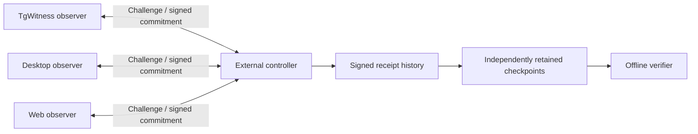

# TgWitness continuity controller

**An interruption stays in the record, even after every observer comes back.**

Local prototype of an external witness for three observers: TgWitness, a desktop client and a web client. The Worker issues unpredictable challenges, checks signed journal commitments and keeps its own signed receipt chain in a SQLite Durable Object.

This service is implemented and testable locally. **The three client adapters are not implemented here.** The supplied demo uses synthetic observations; it does not open Telegram, a browser session or any existing TgWitness account. This is a separate protocol, not a replacement for the current evidence ZIP verifier.



## What it does

| Event | Result |
| --- | --- |
| Valid answer to the current challenge | Checks observer signature and every new commitment; signs a receipt. |
| Identical retry after a lost response | Returns the original receipt. No new confirmation and no deadline extension. |
| Old, foreign or unsigned answer | Rejected. Signature failures are recorded at most once per outstanding challenge. |
| No answer by the deadline | Records an interruption; no confirmation is fabricated for the missing interval. |
| Observer returns | Records recovery. The interruption remains in the run and exported history. |
| Signed rollback, changed commitment or changed declared build | Records the conflict and quarantines that observer for the rest of the run. |
| Collector responds but reports capture stopped | Records capture unavailability instead of displaying a healthy collector. |
| Controller stops between challenges | On return, an overdue dispatch is recorded. It cannot report while it is offline. |
| Receipt removed, rewritten or history shortened | Offline verification fails against an independently retained checkpoint covering that history. |

There is no reset endpoint for incidents, replacement keys or the observation head. Closing a run leaves its receipts available. A new run gets a new random UUID and starts a visibly separate history.

## Randomness, deadlines and signatures

Each challenge contains a fresh 256-bit nonce from Web Crypto, the run and observer IDs, a round number, the previously accepted sequence/hash and a deadline. Observers sign the complete answer with their own Ed25519 keys. The controller signs challenges and receipts with a fourth key.

The next challenge is scheduled randomly **2–6 seconds after an accepted answer**. It must be answered within **12 seconds of issue**. Polling before issue returns `202` and a fixed suggested polling interval, not the future schedule. Polling cannot replace an outstanding challenge or extend its deadline. Runs close after 24 hours.

These bounds are a prototype policy, not a claim of instant detection: a disconnect just after an answer can take up to 18 seconds to cross the configured deadline, plus scheduling/transport delay. A dispatch delayed more than 12 seconds beyond its due time creates a separate incident. Store both the deadline and detection time. [Durable Object alarms](https://developers.cloudflare.com/durable-objects/api/alarms/) may retry and do not provide a hard real-time deadline.

Hidden algorithms are not required. The algorithm can be public while each nonce and future schedule remain unpredictable. Random checks do **not** prevent an already compromised observer from signing a fabricated new observation.

Blocking the answer channel does not destroy a key or invalidate earlier signatures. It leaves a permanent interruption, so the run cannot pass a strict continuity check as uninterrupted. Earlier receipts still cover the history they actually committed to.

## Delayed critical changes

Proxy changes, session replacement and account disconnection can request an external permit. A signed intent binds the exact action and SHA-256 digest of its parameters to a fresh controller challenge. Only one intent can be pending per run, with at most 256 distinct requests per run.

1. The controller records the intent and chooses a hidden hold of **1–60 seconds**. Old settings remain the executor's responsibility during this hold.
2. After the hold, **all three observers must have submitted fresh signed answers**. Old successful responses do not satisfy this condition. These checks can extend the total wait beyond the hold itself.
3. The requester signs a claim bound to a current challenge. The controller issues a permit once, valid for **five seconds**, naming the action, parameter digest and all three confirmed observation heads.
4. Any continuity incident cancels the pending action. A closed run, expired approval window, replay or different parameter digest cannot produce the pending permit.

The signed permit proves authorization, **not execution**. The actual TgWitness action endpoints are not connected yet. A production executor must require the pinned controller signature, enforce expiry, verify the actual parameter digest, durably consume `request_id` once and serialize/revalidate the operation immediately before applying it. It must have no alternate unchecked route to that operation. A lost permit response fails closed; this prototype does not reissue it.

An incident discovered after issuance cannot revoke an offline copy instantaneously. A production executor needs an online consume/check step if that stronger guarantee is required. The current five-second permit bounds that window, but does not eliminate it. A host administrator bypassing the executor is also outside this permit mechanism's enforcement boundary. No production action is delayed or executed by this prototype.

## Try it locally

Requires Node.js 22 or newer. From this directory:

```sh
npm ci
npm run setup:local
npm run dev
```

In another terminal, in the same directory:

```sh
npm run demo
```

The demo registers three synthetic observers, deliberately withholds the web observer's second answer, waits for the interruption, resumes answers and closes the run. It writes `demo-output/receipts.json`, `checkpoint.json`, `report.json` and local read-only dashboard credentials in `access.json`. It only accepts loopback HTTP URLs. For another local port: `npm run demo -- http://127.0.0.1:8791`.

Open the local address printed by Wrangler. Enter the run ID and reader token from `access.json` to see response status and the recorded interruption separately. The dashboard keeps its token in page memory; it is not a substitute for cryptographic verification.

`.dev.vars`, runtime state and demo output are excluded from Git. `setup:local` refuses to overwrite existing keys. On Windows, protect the working directory with your normal user ACLs; POSIX file mode flags are not a Windows access policy. Do not expose the development server or its debugger publicly.

## Verify a receipt history

```sh
node tools/verify.mjs demo-output/receipts.json --checkpoint demo-output/checkpoint.json --public-key YOUR_PINNED_CONTROLLER_KEY
```

For real use, obtain the public key through a trusted independent channel and retain checkpoints **as the run happens**, outside the controller owner's control. The demo saves both files locally for demonstration; that alone is not independent retention. `/v1/key` is a discovery endpoint, not an independent trust anchor.

The verifier checks controller signatures, receipt indices and links, observer signatures, recorded challenges and observation chains. It derives interruptions from signed incidents instead of trusting a status summary. It requires the exported history to reach the supplied checkpoint exactly.

Exit codes: `0` means the receipt history verifies, all three observers have answered and no interruption is recorded **through the supplied checkpoint**; `2` means valid receipts with an interruption or observers still pending; `1` means invalid input or failed verification. None of these establishes Telegram content authenticity. A valid old checkpoint cannot reveal a newer incident that the verifier was never given. Keep the latest checkpoints with an independent monitor; a completed investigation should retain the `run_closed` receipt too.

## API and access

| Route | Credential |
| --- | --- |
| `GET /v1/key` | Public controller key only |
| `POST /v1/runs` | Controller administrator |
| `GET /v1/runs/{run}/status` | Run reader |
| `GET /v1/runs/{run}/checkpoint` | Run reader |
| `GET /v1/runs/{run}/export?after=0&through={index}` | Run reader |
| `GET /v1/runs/{run}/observers/{observer}/challenge` | That observer only |
| `POST /v1/runs/{run}/observers/{observer}/answer` | That observer's token **and** signature |
| `POST /v1/runs/{run}/observers/{observer}/intent` | Signed critical-change intent, bound to its current challenge |
| `POST /v1/runs/{run}/observers/{observer}/permit` | Signed claim for the pending intent, bound to a current challenge |
| `POST /v1/runs/{run}/close` | Controller administrator |

Pass tokens as `Authorization: Bearer …`, never query parameters. Tokens are generated at registration; only their hashes are stored. Exported receipts contain no tokens or private keys. JSON requests are limited to 64 KiB with a five-second body timeout. Slow request bodies are read outside the state lock so they do not block other observers or alarms. Exports return at most 500 receipts per page; hold `through` constant while fetching later pages.

Registration body:

```json
{
  "observers": [
    {"id":"collector","kind":"tgwitness","public_key":"BASE64URL_ED25519","declared_build_digest":"64_LOWERCASE_HEX"},
    {"id":"desktop","kind":"desktop","public_key":"BASE64URL_ED25519","declared_build_digest":"64_LOWERCASE_HEX"},
    {"id":"web","kind":"web","public_key":"BASE64URL_ED25519","declared_build_digest":"64_LOWERCASE_HEX"}
  ]
}
```

The IDs, keys and kinds must be distinct. Key rotation requires a new run. `declared_build_digest` is an observer's declaration, **not runtime attestation**. Reporting the original digest from modified software remains possible without an independent attestation mechanism.

## Observation commitments

An observation contains its sequence number, previous hash, SHA-256 payload digest and new hash. The new hash covers canonical JSON with `format: tgwitness-observation-v1`, `run_id`, `observer_id`, `seq`, `previous`, and `payload_sha256`. The initial previous hash is 64 zeros. Hashes are lowercase hexadecimal; keys/signatures/nonces use unpadded canonical base64url.

`src/protocol.mjs` defines the exact encoding: sorted object keys, JSON strings, safe integers, booleans, null and arrays; no floats, lone surrogates or undefined values. The signed answer binds up to 128 contiguous commitments to the current challenge. A payload can itself be a batch manifest for busy chats, but real adapters must define and preserve that manifest. The controller receives commitments, not message text or files.

## Boundaries and remaining integration

This is a continuity witness, not a sealed collector or a Telegram authenticity oracle. A compromised collector can invent content before its first commitment. An unchanged journal head can also mean no new messages, paused capture or hidden omissions; `capture_active` and `source_status` are self-reported. Independent source observation and cross-client comparison are still required.

Three containers under the same host administrator do not become independent because they use different languages. Keep observer keys, data and control planes separate where practical. The controller administrator and signing key are also trusted; SQLite triggers prevent accidental mutation through normal code, not privileged deletion or a malicious replacement Worker. Independently retained receipts expose conflicting or truncated histories relative to those receipts; they do not eliminate all trust.

Still to implement before operational use:

- Real TgWitness, desktop and web adapters, each maintaining its own durable journal and verifying controller challenges against a pinned key. The synthetic helper deliberately trusts the supplied prior head and is **not** a production adapter.
- An action executor that enforces permits and records actual execution results, including a separately scoped immediate containment path. The controller currently issues authorization receipts only.
- A shared normalization scheme for edits, deletions, bot keyboards and message identity; cross-observer comparison with explicit visibility and timing limits.
- Independent checkpoint retention, controller-outage monitoring and notification delivery. This prototype records incidents and displays them; it does not send Telegram alerts.
- Deployment authentication/rate limits, retention and cost policy. Frequent polling and signed receipts consume resources; no free or fixed-price deployment is assumed.

## Checks and deployment boundary

```sh
npm test
npm run build
npm audit
```

Tests include signature forgery, stale responses, journal rollback/conflicts, timeouts, recovery, controller downtime, offline tampering and a real local `workerd`/SQLite restart. Miniflare is pinned to the version bundled with Wrangler, including its current beta API. It is a development dependency only.

`build` runs `wrangler deploy --dry-run` and publishes nothing. The supplied configuration disables `workers.dev` and preview URLs. A deliberate deployment requires a route, access policy, independent controller ownership where needed, and secrets `ADMIN_TOKEN`, `WITNESS_PRIVATE_KEY` and `WITNESS_PUBLIC_KEY`. Test keys must not be reused in production. No deployment is performed by setup, demo or tests.
