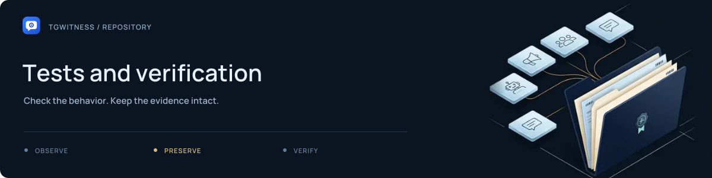

# Tests and verification

[Project](../README.md) · [Documentation](../docs/README.md) · [Wiki](../docs/wiki/Home.md) · [Support](../.github/SUPPORT.md)

Automated checks for collection, account isolation, evidence, interface behavior and
packaging. The suite uses synthetic accounts and fake Telegram transport; live
qualification is recorded separately in the [verification record](../docs/VERIFICATION.md).

## Choose a test area

| Area | Starting points |
| --- | --- |
| Evidence and exports | [`test_evidence.py`](test_evidence.py), [`test_chat_export.py`](test_chat_export.py), [`test_multi_export.py`](test_multi_export.py) |
| Collection and coverage | [`test_collector.py`](test_collector.py), [`test_scope.py`](test_scope.py), [`test_coverage.py`](test_coverage.py), [`test_recheck.py`](test_recheck.py) |
| Accounts and connections | [`test_account_isolation.py`](test_account_isolation.py), [`test_account_import.py`](test_account_import.py), [`test_connection.py`](test_connection.py) |
| Investigation and actions | [`test_investigation.py`](test_investigation.py), [`test_dossier.py`](test_dossier.py), [`test_interactions.py`](test_interactions.py) |
| Witness and recovery | [`test_witness.py`](test_witness.py), [`test_anchor.py`](test_anchor.py), [`test_replica.py`](test_replica.py) |
| UI and documentation | [`test_i18n.py`](test_i18n.py), [`test_site.py`](test_site.py), [`test_wiki.py`](test_wiki.py) |
| Install and release | [`test_installers.py`](test_installers.py), [`test_release.py`](test_release.py), [`test_publication.py`](test_publication.py) |

## Run from the project root

After the [development setup](../.github/CONTRIBUTING.md#development-setup):

```sh
python -m pytest -q
```

For a focused evidence change:

```sh
python -m pytest -q tests/test_evidence.py tests/test_chat_export.py
```

Browser acceptance scripts live in [`tools/`](../tools/README.md). A passing synthetic
test establishes the checked behavior, not a live Telegram delivery guarantee.
