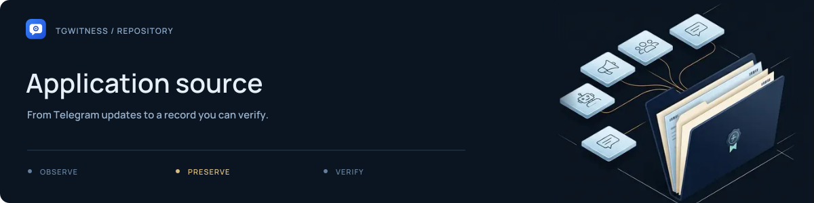

# Application source

[Project](../README.md) · [Documentation](../docs/README.md) · [Wiki](../docs/wiki/Home.md) · [Support](../.github/SUPPORT.md)

TgWitness's Python package: the authenticated panel, account collectors, observation
journal, exports and optional witness services. Start with the component map below;
the detailed data model lives in [Architecture](../docs/ARCHITECTURE.md).

## Find the component

| Area | Files | Responsibility |
| --- | --- | --- |
| Application and accounts | [`app.py`](app.py), [`profiles.py`](profiles.py), [`__main__.py`](__main__.py) | Panel/API, isolated account workspaces and command-line entry points |
| Observation | [`collector.py`](collector.py), [`scope.py`](scope.py), [`monitoring.py`](monitoring.py) | Account-visible updates, selected sources and capture policy |
| Journal and evidence | [`store.py`](store.py), [`evidence.py`](evidence.py), [`verify.py`](verify.py) | Stored records, signed handoffs and standalone verification |
| Investigation views | [`dossier.py`](dossier.py), [`chat_export.py`](chat_export.py), [`message_content.py`](message_content.py) | Saved people observations, chat-history exports and comparable content |
| Deliberate actions | [`interactions.py`](interactions.py), [`keyboard.py`](keyboard.py), [`telegram_client.py`](telegram_client.py) | Panel actions, saved buttons and transport handling |
| Connections | [`network.py`](network.py), [`netclient.py`](netclient.py), [`proxy_catalog.py`](proxy_catalog.py) | Per-account routes and public proxy catalogs |
| Secrets and imports | [`security.py`](security.py), [`account_import.py`](account_import.py), [`sessions.py`](sessions.py), [`tdata.py`](tdata.py) | Vault access and bounded account import handling |
| Independent checks | [`witness.py`](witness.py), [`witness_api.py`](witness_api.py), [`anchor.py`](anchor.py), [`anchoring.py`](anchoring.py) | Witness checkpoints and external timestamps |
| Operations | [`alerts.py`](alerts.py), [`replica.py`](replica.py), [`doctor.py`](doctor.py), [`tuning.py`](tuning.py) | Notifications, off-site copies, local diagnostics and operating parameters |
| Interface | [`static/`](static/README.md), [`locales/`](locales/README.md), [`i18n.py`](i18n.py) | Bundled UI and interface translations |

## Work on the package

Follow the [development setup](../.github/CONTRIBUTING.md#development-setup), then use the
[tests](../tests/README.md) and [browser checks](../tools/README.md) for the affected
workflow. Keep normalization in presentation/search separate from signed payloads.

Read the [evidence format](../docs/EVIDENCE.md) before changing a journal or export.
