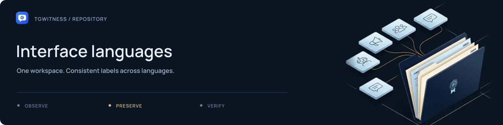

# Interface languages

[Project](../../README.md) · [Documentation](../../docs/README.md) · [Wiki](../../docs/wiki/Home.md) · [Support](../../.github/SUPPORT.md)

Translation dictionaries for the application interface. English is the source;
the JSON files contain Arabic, Spanish, Persian, Hindi, Indonesian, Portuguese,
Russian, Turkish, Ukrainian, Urdu, Vietnamese and Simplified Chinese translations.

## How the pieces fit

| Component | Role |
| --- | --- |
| Language JSON files in this directory | Translated interface strings |
| [`i18n.py`](../i18n.py) | Serves the selected interface dictionary |
| [`static/i18n.js`](../static/i18n.js) | Applies translations in the browser |
| `english_fallbacks.json` in the package | Explicitly catalogued English fallbacks |
| [`i18n_keys.py`](../../tools/i18n_keys.py) | Lists interface strings that translations need to cover |

## Update a translation

Preserve placeholders and markup, and check the actual UI in the selected language.
Account-visible message content and signed journal payloads must stay as captured.
Use [`test_i18n.py`](../../tests/test_i18n.py) to check catalog behavior.

Public-site translations are maintained separately in
[`website/i18n/`](../../website/i18n/README.md).
