[TgWitness](../../../README.md) / [narrative](../README.md)

<picture>
  <source media="(max-width: 640px) and (prefers-reduced-motion: reduce)" srcset="../../../docs/assets/presentation/section-docs-mobile-static.svg">
  <source media="(prefers-reduced-motion: reduce)" srcset="../../../docs/assets/presentation/section-docs-static.svg">
  <source media="(max-width: 640px)" srcset="../../../docs/assets/presentation/section-docs-mobile.svg">
  
</picture>

# Expert examination catalog

Rules for court expert reports, one JSON file per jurisdiction, used by the
narrative CLI's `--expert` protocol. Each file records the official sources,
the check date and the review status of every reference.

| Fields | Purpose |
| --- | --- |
| `format`, `code`, `name_en`, `name_local` | Catalog identity |
| `court_languages`, `local_language` | Court languages; `local_language` is the language of the `*_local` texts |
| `checked_at`, `review`, `open_questions` | Check date, review status and points not confirmed from an official text |
| `expert_term`, `procedures` | Per procedure: appointment, questions, required report contents and expert duties |
| `statute`, `liability`, `declaration` | Law on expert activity, liability for a knowingly false opinion with the warning the expert signs, required declaration |
| `standards` | Digital-evidence standards issued or adopted in the jurisdiction |
| `esignature`, `timestamp` | Electronic signature and timestamp law |

`wording` tells how a warning or declaration was obtained: `official` is quoted
from a statute, rule or official form, `customary` is the formula documented in
practice, `composed` is drafting that follows the cited norm.

The entries are machine-assisted research, not reviewed by local counsel. The
protocol prints the review status and the check date. Before relying on an
entry, confirm each reference against the current official text and keep the
source URL and review metadata when updating it. See [`expert.py`](../expert.py)
for its use and the [narrative guide](../../../docs/NARRATIVE.md#expert-examination-protocol)
for the protocol.
