[TgWitness](../../../README.md) / [narrative](../README.md)

<picture>
  <source media="(max-width: 640px) and (prefers-reduced-motion: reduce)" srcset="../../../docs/assets/presentation/section-docs-mobile-static.svg">
  <source media="(prefers-reduced-motion: reduce)" srcset="../../../docs/assets/presentation/section-docs-static.svg">
  <source media="(max-width: 640px)" srcset="../../../docs/assets/presentation/section-docs-mobile.svg">
  
</picture>

# Jurisdiction reference data

Structured terminology and source references selected by the narrative CLI's
`--jurisdiction` option. Each JSON file records its scope and check date
alongside the terms included in the report.

| Fields | Purpose |
| --- | --- |
| `code`, `scope`, `checked_at` | Catalog identity and check date |
| `expert_role`, `esig_regulation`, `data_access_basis` | Referenced terms and source material |
| `timestamp_recognition`, `evidence_rules`, `dpa` | Additional reference entries, where supplied |
| `sources` | Labels and URLs reproduced in the report |
| `review_updates` | Later partial reviews: date, scope and the sources opened |

Each reference entry has a `term`, a short English `basis` and a `source` URL.
`expert_role`, `data_access_basis` and each `evidence_rules` item carry a `route`
(`civil`, `criminal` or `all`); the report shows `data_access_basis` only for a
matching route. `timestamp_recognition.automatic_ots_qualification` is always
`false`: an OpenTimestamps receipt is not a qualified time stamp. `dpa` names the
supervisory authority (`name`, `name_en`, `basis`, `source`). The report shows the
`evidence_rules` items of the matching route and the `dpa` entry after the other terms.

See [`DE.json`](DE.json) for the file structure and [`render.py`](../render.py)
for its use in reports. Preserve source URLs and check dates when updating
a catalog. The [narrative guide](../../../docs/NARRATIVE.md) explains the scope
of these references.
