[TgWitness](../../../README.md) / [narrative](../README.md)

<picture>
  <source media="(max-width: 640px) and (prefers-reduced-motion: reduce)" srcset="../../../docs/assets/presentation/section-languages-mobile-static.svg">
  <source media="(prefers-reduced-motion: reduce)" srcset="../../../docs/assets/presentation/section-languages-static.svg">
  <source media="(max-width: 640px)" srcset="../../../docs/assets/presentation/section-languages-mobile.svg">
  
</picture>

# Narrative text catalogs

Report text and glossaries for the narrative generator. Supported languages are
listed in [`text.py`](../text.py); this report module has its own language selection.

| Files | Contents |
| --- | --- |
| [`en.json`](en.json) and `<language>.json` | Headings, recorded facts, limitations and diagram captions |
| [`glossary.en.json`](glossary.en.json) and `glossary.<language>.json` | Terms used in the report glossary |

Keep keys and placeholders aligned with English. Plural templates use the bounded
ICU-style syntax implemented in `text.py`. The [narrative guide](../../../docs/NARRATIVE.md)
lists the languages.
