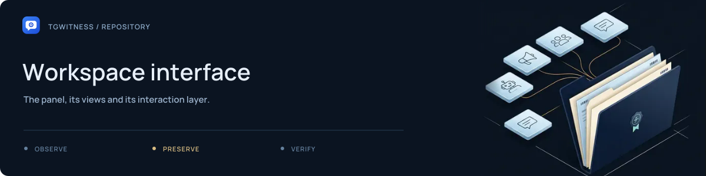

# Workspace interface

[Project](../../README.md) · [Documentation](../../docs/README.md) · [Wiki](../../docs/wiki/Home.md) · [Support](../../.github/SUPPORT.md)

The bundled browser interface served by TgWitness. These are application files;
the separate public documentation website lives in [`website/`](../../website/README.md).

## Files at a glance

| File | Purpose |
| --- | --- |
| [`index.html`](index.html), [`app.js`](app.js), [`style.css`](style.css) | Main workspace, account views, interactions and responsive layout |
| [`theme.js`](theme.js) | Light/dark theme handling |
| [`i18n.js`](i18n.js) | Interface translation handling |
| [`guide.html`](guide.html), [`guide.js`](guide.js), [`guide.css`](guide.css) | In-application setup guidance |
| [`dedicated-account.html`](dedicated-account.html) | Dedicated-account guide |
| [`mark.svg`](mark.svg) | Original TgWitness application mark |

## Review a change

Use the [demo](../../docs/QUICKSTART.md#explore-the-interface) for fictional content.
Check both themes, keyboard navigation and a narrow viewport. Use the relevant
[browser acceptance tool](../../tools/README.md) and refresh screenshots only from
synthetic data. Interface strings belong in the [locale workflow](../locales/README.md).
