[TgWitness](../../../README.md) / [static](../README.md)

<picture>
  <source media="(max-width: 640px) and (prefers-reduced-motion: reduce)" srcset="../../../docs/assets/presentation/section-source-mobile-static.svg">
  <source media="(prefers-reduced-motion: reduce)" srcset="../../../docs/assets/presentation/section-source-static.svg">
  <source media="(max-width: 640px)" srcset="../../../docs/assets/presentation/section-source-mobile.svg">
  
</picture>

# Workspace screens

Screen-specific browser modules and styles. Start here when changing a particular
panel page; shared behavior belongs in [components](../components/README.md) or
[core](../core/README.md).

| Area | Entry points |
| --- | --- |
| Accounts and connection | [`accounts.js`](accounts.js), [`connection.js`](connection.js) |
| Chat navigation | [`chat-list.js`](chat-list.js), [`chats.css`](chats.css) |
| Gap markers in the chat feed | [`chat-gaps.js`](chat-gaps.js) |
| Case Board | [`board.js`](board.js), [`board.css`](board.css) |
| Home overview and charts | [`pulse.js`](pulse.js), [`pulse.css`](pulse.css) |
| Exports | [`exports.js`](exports.js), [`disclosure-preview.js`](disclosure-preview.js) |
| Report studio steps and live preview | [`report-wizard.js`](report-wizard.js), [`report-wizard.css`](report-wizard.css), [`report-selection.js`](report-selection.js) |
| Shared access | [`access.js`](access.js) |
| Account groups | [`group.js`](group.js), [`group-settings.js`](group-settings.js) |

Pair each behavior change with its relevant [browser check](../../../tools/README.md).
The [panel guide](../../../docs/PANEL.md) describes how the screens fit together.
