[TgWitness](../README.md)

<picture>
  <source media="(max-width: 640px) and (prefers-reduced-motion: reduce)" srcset="../docs/assets/presentation/section-capture-mobile-static.svg">
  <source media="(prefers-reduced-motion: reduce)" srcset="../docs/assets/presentation/section-capture-static.svg">
  <source media="(max-width: 640px)" srcset="../docs/assets/presentation/section-capture-mobile.svg">
  
</picture>

# Independent recorder source

Python implementation of the optional capture package: browser and database
recorders, signed journals, video, exports and independent verification.

For installation, use the [add-on guide](../addons/capture/README.md).
The main application's collector is in [`tgwitness/`](../tgwitness/README.md).

## Find the component

| Area | Files |
| --- | --- |
| CLI and recorder service | [`__main__.py`](__main__.py), [`service.py`](service.py) |
| Browser and database acquisition | [`adapters.py`](adapters.py), [`video.py`](video.py) |
| Signed record and handoff | [`journal.py`](journal.py), [`format.py`](format.py), [`export.py`](export.py), [`verify.py`](verify.py) |
| Independent observation | [`witness.py`](witness.py), [`network_witness.py`](network_witness.py), [`beacon.py`](beacon.py) |
| Official Web | [`official.py`](official.py), [`official_api.py`](official_api.py), [`official_proof.py`](official_proof.py), [`gateway.py`](gateway.py) |
| Trusted Live | [`trusted_runtime.py`](trusted_runtime.py), [`trusted_service.py`](trusted_service.py), [`trusted_anchor.py`](trusted_anchor.py), [`trusted_verify.py`](trusted_verify.py) |
| Continuity | [`continuity.py`](continuity.py) |
| Recorder interfaces | [static/](static/README.md) |

## Inspect the commands

After [installing the package](../addons/capture/README.md#local-installation), run
from the repository root:

```sh
python -m tgwitness_capture --help
python -m tgwitness_capture verify --help
```

The CLI exposes `serve`, `identity`, `export`, `verify` and `witness`.
[Configuration examples](../addons/capture/config/README.md) are maintained with
the add-on; capture regressions remain in the private validation workspace.
