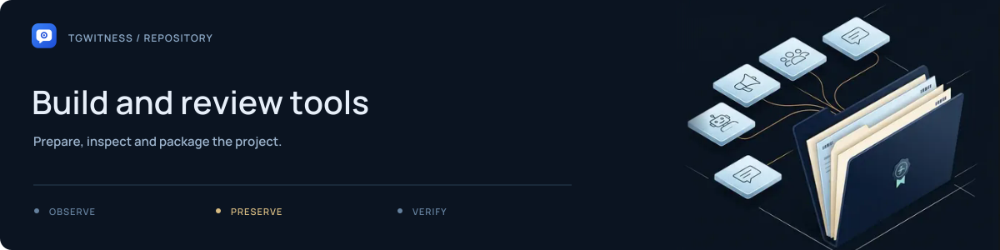

# Build tools

Run from the repo root after [dev setup](../.github/CONTRIBUTING.md#development-setup).

## Build

| Command | Output |
| --- | --- |
| `python tools/build_source.py` | Source ZIP + checksums in `dist/` |
| `python -I tools/check_source_archive.py` | Source ZIP repeatability, exact bytes and failed-build recovery |
| `python tools/build_wiki.py` | Wiki bundle in `dist/` |
| `python tools/build_site.py` | Static site, Markdown editions, `llms.txt` and `llms-full.txt` |
| `python tools/build_portable.py` | Windows portable ZIP; see `--help` |
| `python tools/sync_notice.py --check` | Check NOTICE copies; omit `--check` to sync |

Builds stay local. See [publishing](../docs/internal/PUBLISHING.md) and
[Wiki setup](../docs/internal/WIKI.md) for deployment.

## Check

| Command | Scope |
| --- | --- |
| `python tools/check_publication.py` | Package contents, local links, known secret formats |
| `python tools/check_site.py` | Site smoke test |
| `python tools/check_docs_site.py` | Docs, search and diagrams |
| `python tools/check_browser.py` | Panel flow with fake Telegram data |
| `python tools/check_collector_authorization.py` | Account-loss causes, stale connections and signed coverage gaps |
| `python tools/check_account_export_browser.py` | Account-export scope, disclosure preview, access and narrow-screen flows |
| `python tools/check_cloud_wizard.py` | Server 24/7 wizard and `tgwitness.cloud` against simulated Hetzner, Cloudflare and ntfy.sh |
| `python tools/check_evidence_witnesses.py` | Evidence mode's drand and device-list records, through export and `verify.py`; `--live` asks the real drand relays |
| `python tools/check_gateway_dns.py` | Gateway DNS for a 24/7 server: firewall rules, installer, verify, shared location, the journal copy and the panel; `--no-browser` skips the panel |
| `python tools/check_setup_levels.py` | Setup by goal: the proposal per goal, what Apply changes and records, the credibility and reliability scales, in the browser |
| `python tools/check_first_run.py` | First setup: every string in all panel languages; step addresses and Back, the separate/main account question and its limits, the live check after Start, the IP mode journal record; every step at four widths in English, Russian, German and Arabic |
| `python tools/check_group_settings_browser.py` | Group settings in the browser; API in `tools/test_group_settings.py` |
| `python tools/check_group_screen_browser.py` | Group screen `/groups/<id>` in the browser; API and group export in `tools/test_group_overview.py` |
| `python tools/check_tdx.py` | Intel TDX attestations: real quotes from dcap-qvl and dstack to Intel's root, and every refusal with a forged PKI |
| `python tools/check_phala.py` | Phala Cloud deployments against a simulated Phala Cloud: deploy, verify, the journal, quick tunnel, destroy and the panel wizard |
| `python tools/check_dstack_image.py` | MRTD and RTMR0-2 from a dstack OS image and QEMU's ACPI tables: QEMU's own output, a real Phala Cloud quote, every substitution; `--live` downloads the published image |
| `python tools/check_attestation_report.py` | The attestation certificate: real qualified eIDAS and FreeTSA time stamps, the verifier's seal, the signed PDF, and every change refused |
| `python tools/capture_screenshots.py` | Screenshots in `test-results/`; `--docs` updates docs assets |
| `python tools/capture_demo.py` | Refresh `website/demo/fixtures.json` from the local demo |

Account, workspace, navigation, interaction and proxy checks have their own
`check_*_browser.py` scripts. Browser checks need Playwright; container checks need Docker.

## Docs and utilities

- [site_content.py](site_content.py): page inventory.
- [site_wiki.py](site_wiki.py): Markdown rendering.
- [site_diagrams.py](site_diagrams.py): interactive diagrams.
- [site_i18n.py](site_i18n.py) / [i18n_keys.py](i18n_keys.py): site and panel translations.
- [site_llms.py](site_llms.py): task index and text editions of the public handbook. Generated from the same page inventory; no account data or application imports.
- [verify_live_probe.py](verify_live_probe.py): verify an existing probe export.
- [check_capacity.py](check_capacity.py): local benchmark.
- [research_sources.py](research_sources.py): fetch upstream API docs.
