[TgWitness](../README.md)

<picture>
  <source media="(max-width: 640px) and (prefers-reduced-motion: reduce)" srcset="../docs/assets/presentation/section-tools-mobile-static.svg">
  <source media="(prefers-reduced-motion: reduce)" srcset="../docs/assets/presentation/section-tools-static.svg">
  <source media="(max-width: 640px)" srcset="../docs/assets/presentation/section-tools-mobile.svg">
  
</picture>

# Build tools

Run from the repo root after [dev setup](../.github/CONTRIBUTING.md#development-setup).

## Build

| Command | Output |
| --- | --- |
| `python tools/build_source.py` | Source ZIP + checksums in `dist/` |
| `python tools/build_standalone_verifier.py` | Assemble [verifier sources](../tgwitness/verifier/README.md) into one `verify.py`; `--check` detects drift |
| `python tools/build_wiki.py` | Wiki bundle in `dist/` |
| `python tools/build_site.py` | Static site, Markdown editions, `llms.txt` and `llms-full.txt` |
| `python tools/build_portable.py` | Windows portable ZIP; see `--help` |
| `python tools/build_verifier.py` | Windows verifier bundle; uses the fictional demo for validation, or `--validation-archive PATH` |
| `python tools/sync_notice.py --check` | Check NOTICE copies; omit `--check` to sync |

Builds stay local. See [publishing](../docs/internal/PUBLISHING.md) and
[Wiki setup](../docs/internal/WIKI.md) for deployment.

## Validation

| Command | Scope |
| --- | --- |
| `python tools/publication_guard.py --git-index` | Public source selection, local links, language catalogues, known secret formats and staged content |
| `python -m ruff check .` | Python static checks |

Regression tests, fixtures and runners are maintained in the private validation
workspace. Preserve them when publishing. See the [validation map](../docs/AGENT-GUIDE.md#validation)
and [qualification record](../docs/STATUS.md) for the required scope and remaining limits.

## Docs and utilities

- [site_content.py](site_content.py): page inventory.
- [site_wiki.py](site_wiki.py): Markdown rendering.
- [site_diagrams.py](site_diagrams.py): interactive diagrams.
- [site_i18n.py](site_i18n.py) / [i18n_keys.py](i18n_keys.py): site and panel translations.
- [site_llms.py](site_llms.py): task index and text editions of the public handbook. Generated from the same page inventory; no account data or application imports.
- [verify_live_probe.py](verify_live_probe.py): verify an existing probe export.
- [bench_fulltext.py](bench_fulltext.py): full-text index build and query timing on a synthetic signed journal.
- [export_clinic_preview.py](export_clinic_preview.py): loopback preview of the Export Clinic's allowlisted downloads, using [site_test_server.py](site_test_server.py).
- [research_sources.py](research_sources.py): fetch upstream API docs.
