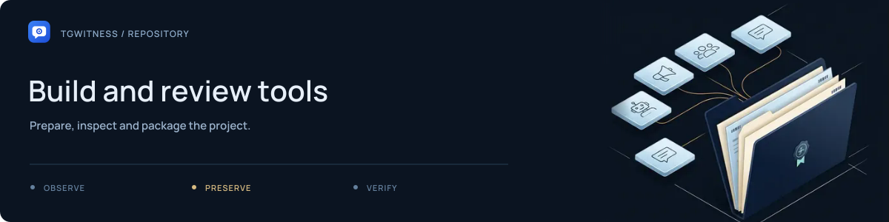

# Build tools

Run from the repo root after [dev setup](../.github/CONTRIBUTING.md#development-setup).

## Build

| Command | Output |
| --- | --- |
| `python tools/build_source.py` | Source ZIP + checksums in `dist/` |
| `python tools/build_wiki.py` | Wiki bundle in `dist/` |
| `python tools/build_site.py` | Static site, Markdown editions, `llms.txt` and `llms-full.txt` |
| `python tools/build_portable.py` | Windows portable ZIP; see `--help` |
| `python tools/sync_notice.py --check` | Check NOTICE copies; omit `--check` to sync |

Builds stay local. See [publishing](../docs/internal/PUBLISHING.md) and
[Wiki setup](../docs/internal/WIKI.md) for deployment.

## Check

| Command | Scope |
| --- | --- |
| `python tools/check_publication.py` | Package contents, local links, known secret formats |
| `python tools/check_site.py` | Site smoke test |
| `python tools/check_docs_site.py` | Docs, search and diagrams |
| `python tools/check_browser.py` | Panel flow with fake Telegram data |
| `python tools/capture_screenshots.py` | Screenshots in `test-results/`; `--docs` updates docs assets |
| `python tools/capture_demo.py` | Refresh `website/demo/fixtures.json` from the local demo |

Account, workspace, navigation, interaction and proxy checks have their own
`check_*_browser.py` scripts. Browser checks need Playwright; container checks need Docker.

## Docs and utilities

- [site_content.py](site_content.py): page inventory.
- [site_wiki.py](site_wiki.py): Markdown rendering.
- [site_diagrams.py](site_diagrams.py): interactive diagrams.
- [site_i18n.py](site_i18n.py) / [i18n_keys.py](i18n_keys.py): site and panel translations.
- [site_llms.py](site_llms.py): task index and text editions of the public handbook. Generated from the same page inventory; no account data or application imports.
- [verify_live_probe.py](verify_live_probe.py): verify an existing probe export.
- [check_capacity.py](check_capacity.py): local benchmark.
- [research_sources.py](research_sources.py): fetch upstream API docs.
