[TgWitness](../README.md)

<picture>
  <source media="(max-width: 640px) and (prefers-reduced-motion: reduce)" srcset="../docs/assets/presentation/section-website-mobile-static.svg">
  <source media="(prefers-reduced-motion: reduce)" srcset="../docs/assets/presentation/section-website-static.svg">
  <source media="(max-width: 640px)" srcset="../docs/assets/presentation/section-website-mobile.svg">
  
</picture>

# Website

Landing page, docs and demo. The app UI lives in
[tgwitness/static/](../tgwitness/static/README.md).

| Files | Use |
| --- | --- |
| [index.html](index.html), [style.css](style.css), [site.js](site.js) | Homepage |
| [docs.html](docs.html), [docs.css](docs.css), [docs.js](docs.js) | Docs layout and search |
| [guide_intro.html](guide_intro.html), [guides/](guides/README.md) | Guides |
| [learn.css](learn.css), [learn.js](learn.js) | Interactive examples |
| [i18n/](i18n/README.md) | Translations |
| [demo/](demo/README.md) | Demo API mock, fixtures and downloadable examples |
| [export-clinic/](export-clinic/README.md) | Interactive export-file comparison and review materials |
| [validation/](validation/README.md) | Dated measurements, performance charts and the signed English audit |
| [capture_readme.py](capture_readme.py) | Demo recordings for the README |
| `render_*.py` | Artwork; see the [asset guide](../docs/assets/presentation/README.md) |

## Build

```sh
python tools/sync_notice.py --check
python tools/build_site.py
python tools/check_site.py
```

Edit source files here, not the output in `dist/`. Check keyboard navigation,
both themes and the no-JS fallback. Examples use demo data; keep diagrams aligned
with the [evidence model](../docs/EVIDENCE.md).

[Local preview](../docs/internal/PUBLISHING.md#preview-the-website-locally) ·
[Publish to Pages](../docs/internal/PUBLISHING.md#publish-the-generated-static-branch)
