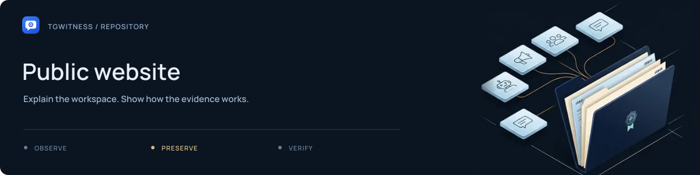

# Public website

[Project](../README.md) · [Documentation](../docs/README.md) · [Wiki](../docs/wiki/Home.md) · [Support](../SUPPORT.md)

Source templates, styles, interactive examples and translations for the TgWitness
project website. The authenticated application panel lives in
[`tgwitness/static/`](../tgwitness/static/README.md).

## Source map

| Files | Purpose |
| --- | --- |
| [`index.html`](index.html), [`style.css`](style.css), [`site.js`](site.js) | Project landing page and shared presentation |
| [`docs.html`](docs.html), [`docs.css`](docs.css), [`docs.js`](docs.js) | Documentation layout and local search |
| [`guide_intro.html`](guide_intro.html), [`guides/`](guides/README.md) | Practical guide content |
| [`learn.css`](learn.css), [`learn.js`](learn.js) | Interactive explanatory examples |
| [`i18n/`](i18n/README.md) | Public-site translation catalogues |
| [`artwork.html`](artwork.html), [`render_artwork.py`](render_artwork.py) | Original HTML/CSS presentation artwork and renderer |

## Build and inspect

From the project root:

```sh
python tools/build_site.py
python tools/check_site.py
```

Follow the [local preview instructions](../docs/internal/PUBLISHING.md#preview-the-website-locally)
for serving the generated pages. Edit these sources, not generated files in `dist/`.
Preserve keyboard navigation, both themes and the no-JavaScript fallback.

The examples use fictional data. Changes to explanatory diagrams should stay aligned
with the [evidence model](../docs/EVIDENCE.md).
