[TgWitness](../../README.md) / [website](../README.md)

<picture>
  <source media="(max-width: 640px) and (prefers-reduced-motion: reduce)" srcset="../../docs/assets/presentation/section-website-mobile-static.svg">
  <source media="(prefers-reduced-motion: reduce)" srcset="../../docs/assets/presentation/section-website-static.svg">
  <source media="(max-width: 640px)" srcset="../../docs/assets/presentation/section-website-mobile.svg">
  
</picture>

# Interactive demo

The public demo uses fictional records and a browser API mock. It lets visitors
explore the workspace without signing in to Telegram. It is a panel walkthrough.
The [validation record](../../docs/VERIFICATION.md) and
[public-history qualification](../../docs/EXPORT-BENCHMARK-2026-11-06.md) document
runtime and acquisition checks with their own revisions, workloads and results.

| Content | Purpose |
| --- | --- |
| [`mock.js`](mock.js) | Browser-side API responses and simulated actions |
| [`fixtures.json`](fixtures.json) | Recorded synthetic workspace data |
| [`secret-chats.html`](secret-chats.html), [`secret-chats.js`](secret-chats.js), [`secret-chats.css`](secret-chats.css) | Fictional Secret Chat interaction, kept in browser memory |
| [downloads/](downloads/README.md) | Example exports and verification files |
| [report/](report/README.md) | Example report and sharing copy |
| [scale/](scale/README.md) | Signed measurement renderer; run data supplied separately |

## Build and preview

**Try Secret Chat** appears in the demo banner and Sources. Start a sample chat,
simulate peer acceptance, accept an incoming request, send a fictional message,
receive a scripted reply or file, and simulate deletion while retaining the copy.
Reset clears the scenario. It makes no Telegram requests and does not alter the
signed sample downloads. See [implementation status](../../docs/PSEUDO-SECRET.md).

Run from the repository root:

```sh
python tools/build_site.py
```

Follow the [local preview instructions](../../docs/internal/PUBLISHING.md#preview-the-website-locally)
and open the generated demo. The builder combines these files with the application
interface; this directory is not a standalone copy of that interface.

Refresh synthetic fixtures using the private capture tools. Keep mock behavior
aligned with the [panel guide](../../docs/PANEL.md).
