[TgWitness](../../../README.md) / [demo](../README.md)

<picture>
  <source media="(max-width: 640px) and (prefers-reduced-motion: reduce)" srcset="../../../docs/assets/presentation/section-examples-mobile-static.svg">
  <source media="(prefers-reduced-motion: reduce)" srcset="../../../docs/assets/presentation/section-examples-static.svg">
  <source media="(max-width: 640px)" srcset="../../../docs/assets/presentation/section-examples-mobile.svg">
  
</picture>

# Demo exports

Downloadable examples for the public demo. Their messages and account records are
fictional, so visitors can inspect the export formats without collecting a chat.
The main sample ZIP records producer version **0.7.0** and a fictional scenario.
Its signatures exercise archive integrity and report rendering for those sample
records. Current collection, GitHub acquisition and Intel TDX qualification are
documented in the [validation record](../../../docs/VERIFICATION.md), with the
corresponding workflow and tested revision.

| Files | What to inspect |
| --- | --- |
| [`tgwitness-demo.zip`](tgwitness-demo.zip) | Signed evidence package |
| [JSONL](tgwitness-demo.jsonl), [CSV](tgwitness-demo.csv), [HTML](tgwitness-demo.html) | Alternate views of the example record |
| [Checkpoint](tgwitness-demo-checkpoint.json), [run receipt](tgwitness-demo-run-receipt.json) | Verification and collection metadata |
| [Timestamp request](tgwitness-demo-timestamp-request.zip) | Example request package |
| [Account export](tgwitness-demo-account-export.zip) | Account-level handoff |
| [Minimized disclosure](tgwitness-demo-minimized-disclosure.zip) | A selected sharing copy |

The [site builder](../../../tools/build_site.py) copies the listed demo artifacts
into the public site. Read [Exports and verification](../../../docs/wiki/Exports-and-Verification.md)
for the real handoff procedure and trusted verification inputs.
