[TgWitness](../../../README.md) / [demo](../README.md)

<picture>
  <source media="(max-width: 640px) and (prefers-reduced-motion: reduce)" srcset="../../../docs/assets/presentation/section-examples-mobile-static.svg">
  <source media="(prefers-reduced-motion: reduce)" srcset="../../../docs/assets/presentation/section-examples-static.svg">
  <source media="(max-width: 640px)" srcset="../../../docs/assets/presentation/section-examples-mobile.svg">
  
</picture>

# Example case report

Synthetic report materials linked from the public demo.

| File | Purpose |
| --- | --- |
| [`index.html`](index.html) | Report example entry page |
| [`report.html`](report.html) | Readable report |
| [`example.json`](example.json) | Structured example data |
| [`sharing-copy.zip`](sharing-copy.zip) | Downloadable sharing copy |

Preview these through the [built website](../../README.md#build), and use the
[case-report guide](../../../docs/CASE_REPORTS.md) for the actual report workflow.
Keep the example's narrative, structured data and downloadable copy consistent
when refreshing it.
