[TgWitness](../../README.md) / [website](../README.md)

<picture>
  <source media="(max-width: 640px) and (prefers-reduced-motion: reduce)" srcset="../../docs/assets/presentation/section-website-mobile-static.svg">
  <source media="(prefers-reduced-motion: reduce)" srcset="../../docs/assets/presentation/section-website-static.svg">
  <source media="(max-width: 640px)" srcset="../../docs/assets/presentation/section-website-mobile.svg">
  
</picture>

# Export Clinic

An interactive comparison of Telegram conversations and deliberately altered
Desktop export files. The page pairs the demonstration with capture and
verification guidance.

| File or directory | Purpose |
| --- | --- |
| [`page.html`](page.html) | Page content |
| [`export-clinic.js`](export-clinic.js) | Comparison controls |
| [`export-clinic.css`](export-clinic.css) | Page-specific layout |
| [media/](media/README.md) | Published comparison images, manifests and review notes |

## Review a change

Build from the repository root with `python tools/build_site.py`, then follow the
[local preview guide](../../docs/internal/PUBLISHING.md#preview-the-website-locally).
Check the original/modified labels, image captions, keyboard controls and links to
the [published review package](media/REVIEW_README.md).

The demonstration uses test accounts and scripted conversations. Preserve the
distinction between the conversation, the exported file and the altered copy.
