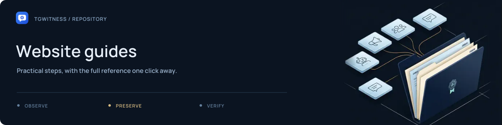

# Website guides

[Project](../../README.md) · [Documentation](../../docs/README.md) · [Wiki](../../docs/wiki/Home.md) · [Support](../../.github/SUPPORT.md)

HTML source fragments for the public site's practical guides. The English source is
in [`en/`](en/README.md); language handling is described in
[`../i18n/`](../i18n/README.md).

The guide inventory and next-page order are defined in
[`tools/site_content.py`](../../tools/site_content.py). The builder combines these
fragments with the documentation layout, navigation and translated text.

## Edit a guide

Keep instructions consistent with the corresponding document in
[`docs/`](../../docs/README.md). Build and check the site using the commands in
the [website README](../README.md). Use fictional examples and retain record
references in investigation walkthroughs.

The [`ru/`](ru/README.md) directory currently contains no translated HTML guide
fragments; public-site language catalogues are maintained separately.
