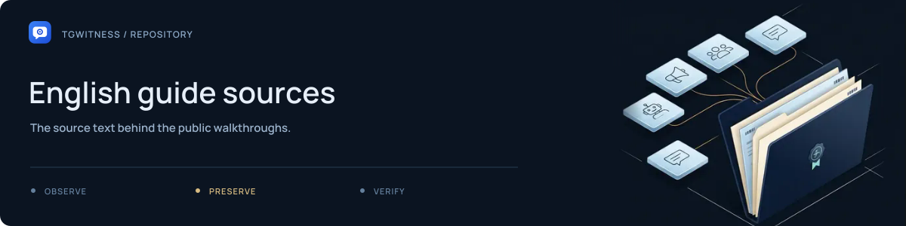

# English guide sources

[Project](../../../README.md) · [Documentation](../../../docs/README.md) · [Wiki](../../../docs/wiki/Home.md) · [Support](../../../SUPPORT.md)

Each HTML fragment covers one practical workflow. The shared shell, navigation and
translations are applied by [`build_site.py`](../../../tools/build_site.py).

| Guide | Subject |
| --- | --- |
| [`start.html`](start.html) | Demo and first setup |
| [`accounts.html`](accounts.html) | Account connection |
| [`proxies.html`](proxies.html) | Connection routes |
| [`cases.html`](cases.html) | Investigation across sources |
| [`exports.html`](exports.html) | Signed handoff and verification |
| [`concepts.html`](concepts.html) | Hash chains and evidence concepts |
| [`security.html`](security.html) | Data handling and protections |
| [`witness.html`](witness.html) | Independent checkpoints |
| [`proof.html`](proof.html) | Public Proof pilot |
| [`server.html`](server.html) | Persistent operation |
| [`troubleshooting.html`](troubleshooting.html) | Diagnosing problems |

For build instructions and browser checks, see the [website README](../../README.md).
