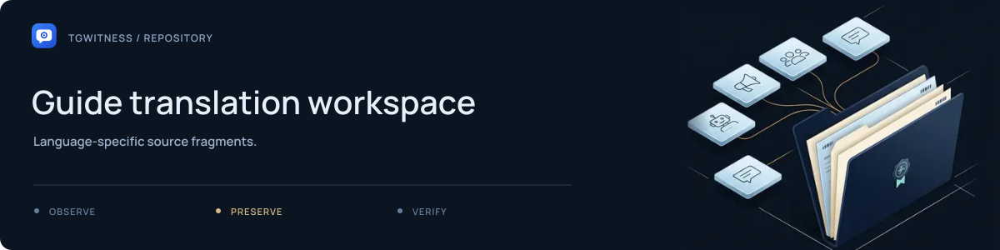

# Guide translation workspace

[Project](../../../README.md) · [Documentation](../../../docs/README.md) · [Wiki](../../../docs/wiki/Home.md) · [Support](../../../.github/SUPPORT.md)

This directory currently has no Russian HTML guide fragments. The public website's
Russian text is maintained in the language catalogue under
[`website/i18n/`](../../i18n/README.md), with English guide sources in
[`../en/`](../en/README.md).

The Russian Markdown documentation is available in
[`docs/ru/`](../../../docs/ru/README.md). Adding a fragment here alone does not make
the site builder use it; check its explicit input inventory first.
