[TgWitness](../../../README.md) / [guides](../README.md)

<picture>
  <source media="(max-width: 640px) and (prefers-reduced-motion: reduce)" srcset="../../../docs/assets/presentation/section-languages-mobile-static.svg">
  <source media="(prefers-reduced-motion: reduce)" srcset="../../../docs/assets/presentation/section-languages-static.svg">
  <source media="(max-width: 640px)" srcset="../../../docs/assets/presentation/section-languages-mobile.svg">
  
</picture>

# Guide translation workspace

This directory currently has no Russian HTML guide fragments. The public website's
Russian text is maintained in the language catalogue under
[`website/i18n/`](../../i18n/README.md), with English guide sources in
[`../en/`](../en/README.md).

The Russian Markdown documentation is available in
[`docs/ru/`](../../../docs/ru/README.md). Adding a fragment here alone does not make
the site builder use it; check its explicit input inventory first.
