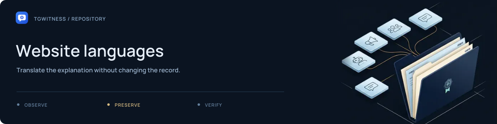

# Website languages

[Project](../../README.md) · [Documentation](../../docs/README.md) · [Wiki](../../docs/wiki/Home.md) · [Support](../../SUPPORT.md)

Language catalogues for the public website, separate from the application's
[`tgwitness/locales/`](../../tgwitness/locales/README.md) dictionaries.

English source templates live in [`website/`](../README.md). The language JSON files
provide translated site text; [`site_i18n.py`](../../tools/site_i18n.py) defines language
metadata, direction and translation handling.

## Review a catalogue change

Preserve placeholders, URLs, element identifiers and code examples. Rebuild the site
and inspect navigation, search and the changed guide in its language. Arabic, Persian
and Urdu also need a right-to-left layout check.

```sh
python tools/build_site.py
python tools/check_site.py
```

Run these commands from the project root. See [website development](../README.md)
for the rest of the workflow.
