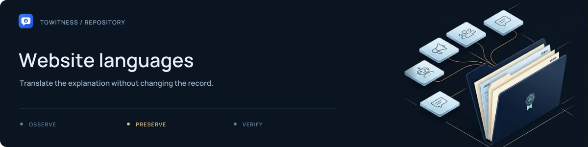

# Website languages

[Project](../../README.md) · [Documentation](../../docs/README.md) · [Wiki](../../docs/wiki/Home.md) · [Support](../../.github/SUPPORT.md)

Language catalogues for the public website, separate from the application's
[`tgwitness/locales/`](../../tgwitness/locales/README.md) dictionaries.

English source templates live in [`website/`](../README.md). The language JSON files
provide translated site text; [`site_i18n.py`](../../tools/site_i18n.py) defines language
metadata, direction and translation handling.

The capability guide uses a `modes` dictionary of stable keys in all 26 catalogues.
English lives in `en.json`; other site pages keep their existing `strings`/`blocks`
format. Add or change a guide key in every language together. Translation text is
escaped at build time and never inserted as executable markup. Code examples and
fictional protocol fixtures remain language-neutral.

The homepage, documentation, cases, reference pages and application panel share
25 languages. [`site_modes.py`](../../tools/site_modes.py) additionally retains
Amharic for the capability guide and both project notices.
Initial translations were prepared with DeepL, with a separate Amharic translation because
the configured DeepL API does not offer Amharic. Russian terminology and limitations
were additionally reviewed. These are not certified or native-speaker-reviewed
translations; review technical limitations when editing a catalogue.

The licence-position and operator-notice pages use the same `strings`/`blocks`
catalogues as the rest of the site. All 26 languages include their full text,
including quoted paragraphs. The original MIT `LICENSE` and plain-text `NOTICE`
remain unchanged. A missing notice translation stops the site build.

After updating notice translations, run `python tools/sync_notice_translations.py`
to regenerate both documents under `docs/<language>/` and links in existing READMEs.
`python tools/sync_notice_translations.py --check` checks that these copies match
the website catalogues. Amharic keeps translated notice navigation and search;
its other documentation links open English. All 25 full-site languages keep
documentation links, navigation and search in the selected language.

English is the only required language. A missing label or text block in another
full-site language is shown in English, the page shows its translation notice, and the
build lists the pending translations instead of failing. When an English source
changes, add translations for the new blocks and review them before publishing the site.

Homepage prose uses fullwidth punctuation, applied by
[`site_typography.py`](../../tools/site_typography.py) after translation and HTML
rendering, including accessible labels and the homepage's JavaScript dictionary.
Keep catalogue punctuation editable as usual. Commands, code, URLs, filenames,
versions and interpolation keys retain their literal syntax. For additional literal
HTML content, use `data-typography="literal"`. Documentation and the application
panel keep their existing typography. When an English passage is rephrased without
changing its meaning, retain the translation under the new block digest as well as
any old digest still used elsewhere.

## Review a catalogue change

Preserve placeholders, URLs, element identifiers and code examples. Rebuild the site
and inspect navigation, search and the changed guide in its language. Arabic, Persian
Urdu and Hebrew also need a right-to-left layout check.

```sh
python tools/build_site.py
python tools/check_site.py
```

Run these commands from the project root. See [website development](../README.md)
for the rest of the workflow.
